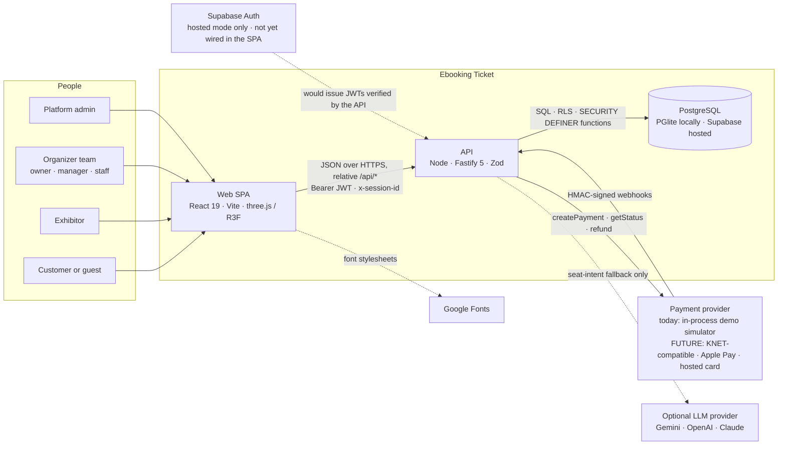
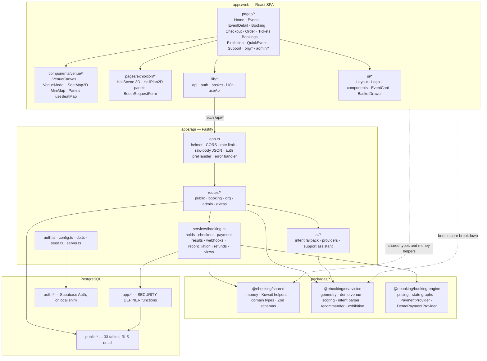
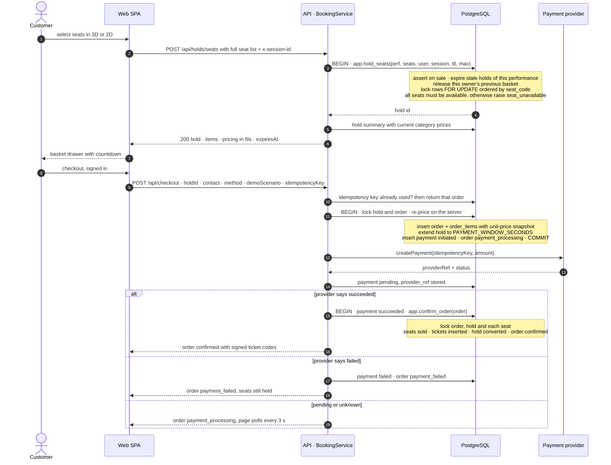
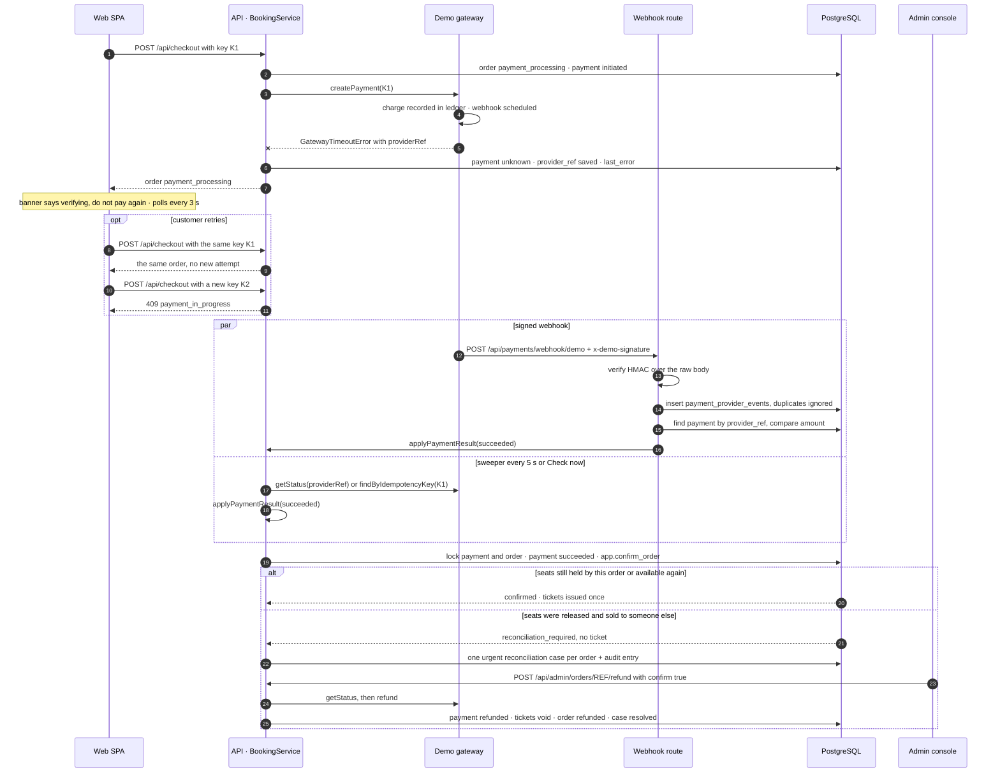
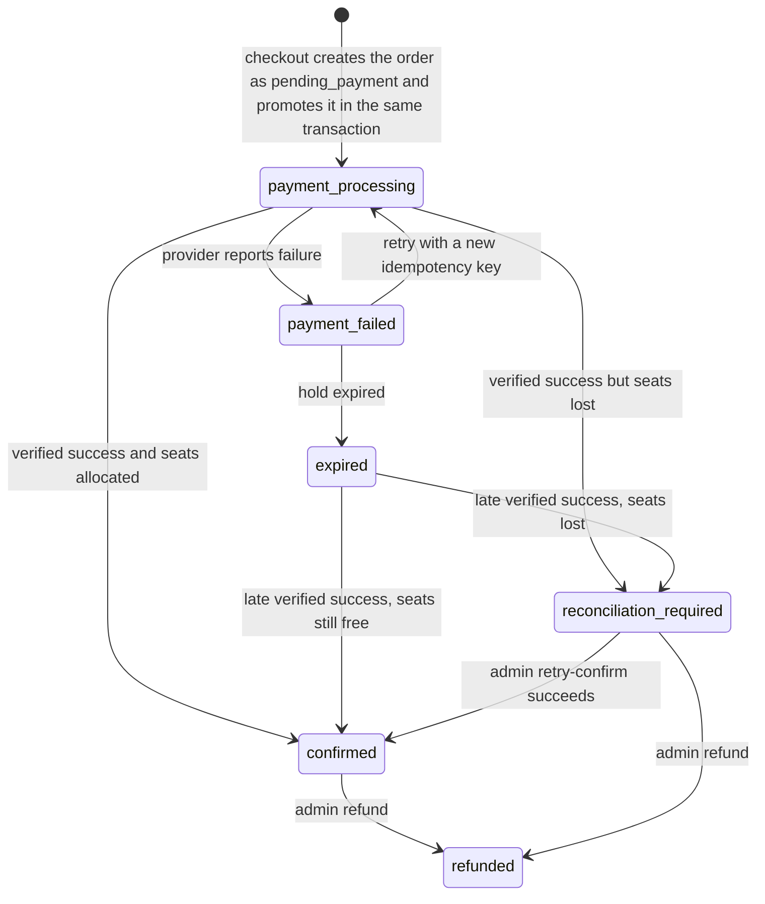
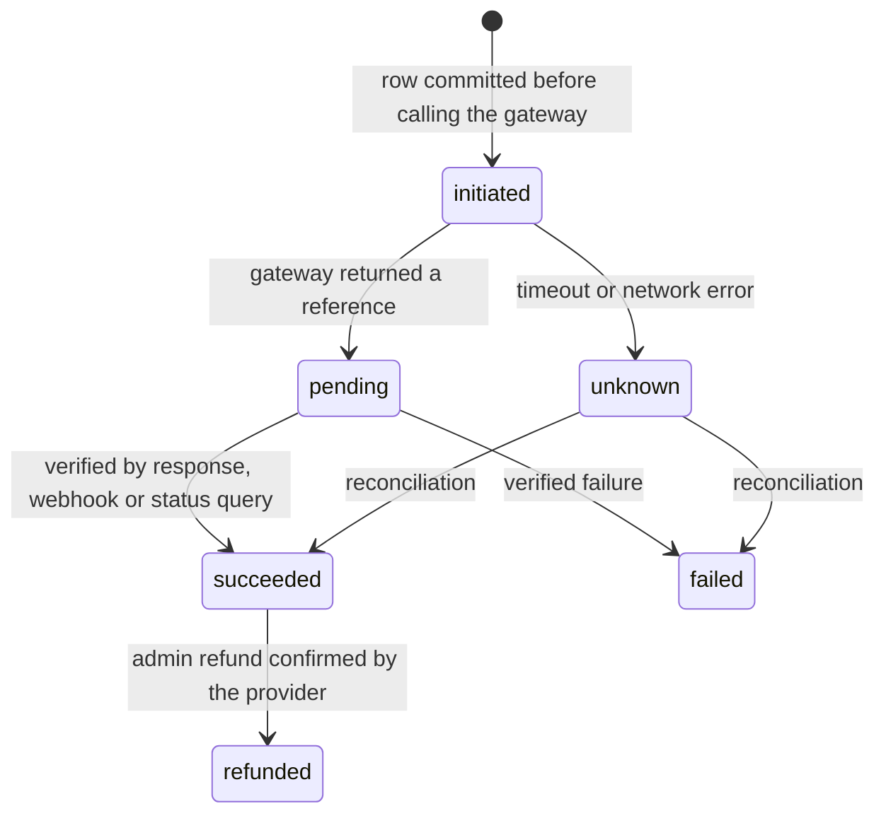
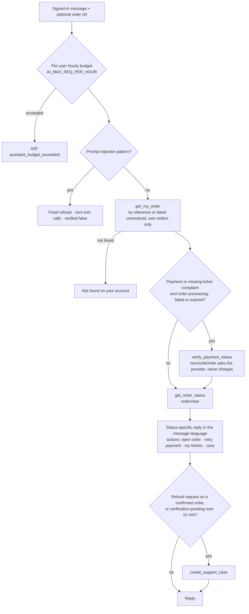
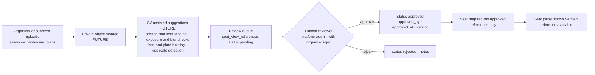
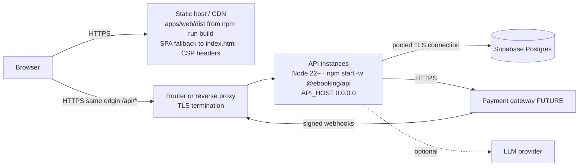

# Ebooking Ticket — Architecture

> **Status:** describes the MVP **as built** (demo build, November 2026). Items marked **FUTURE** are designs, not code. Items marked **Known gap** are verified differences between the code and the intended design; they are collected in §19.
>
> Related: [PRD.md](./PRD.md) · [ERD.md](./ERD.md) · [API-CONTRACTS.md](./API-CONTRACTS.md) · [DESIGN-SYSTEM.md](./DESIGN-SYSTEM.md) · [SECURITY.md](./SECURITY.md) · [TEST-PLAN.md](./TEST-PLAN.md)

---

## 1. Architectural principles

1. **The database is the referee.** Inventory, holds, ticket issuance and check-in are decided inside PostgreSQL transactions with row locks and unique indexes — never in the browser, never by API-instance memory.
2. **The server computes every price.** Clients send seat ids or quantities; the server prices them in integer fils.
3. **A payment is real only when verified.** Provider responses, signed webhooks or provider status queries count; browser redirects never do. Unknown outcomes are reconciled, never blindly retried.
4. **AI is optional and isolated.** The product works fully with `AI_PROVIDER=none`; a language model may only interpret text into a validated preference structure.
5. **Accessible by default, 3D by choice.** Every 3D action has a 2D, keyboard and screen-reader path.
6. **Same SQL everywhere.** One set of migrations runs on embedded PGlite locally and on Supabase Postgres when hosted.
7. **Honest data.** Scores are *estimated*, previews carry an authenticity level, demo data is labelled, unapproved prices are *Price on Request*.

---

## 2. System context



Trust boundaries: browser (untrusted) → API (authenticates and authorizes every request) → PostgreSQL (RLS + server-only functions) → payment provider (signed webhooks) → LLM (untrusted output). Details in [SECURITY.md](./SECURITY.md).

---

## 3. Component view



---

## 4. Monorepo structure

npm workspaces (`package.json` → `packages/*`, `apps/*`), TypeScript `strict` everywhere, ESM.

```text
apps/
  web/                 React 19 SPA (Vite 6, react-router 7, three.js r171, @react-three/fiber 9, drei 10)
    public/            favicon.svg, icon-192.svg, manifest.webmanifest
    src/
      components/venue/  SeatVision 3D + 2D seat map, mini-map, panels, seat-map hook
      pages/             route screens; org/ (organizer portal); admin/ (platform console); exhibition/ (SpaceVision)
      lib/               fetch wrapper, auth, basket (server hold), i18n, data hook
      ui/                layout, logo, shared components, event card, basket drawer
      styles.css         design tokens and base components
  api/                 Fastify 5 API, run with tsx (no separate compile step)
    src/
      routes/          public.ts · booking.ts · org.ts · admin.ts · extras.ts
      services/        booking.ts (BookingService)
      ai/              intent.ts · providers.ts · support.ts
      app.ts · auth.ts · config.ts · db.ts · seed.ts · server.ts · scripts/reset-db.ts
      *.test.ts        API integration tests (Vitest + Fastify inject + PGlite)
packages/
  shared/              money (integer fils), Kuwait mobile, domain enums, Zod request schemas
  seatvision/          demo venue generator, scoring, intent parser, recommender, exhibition layout + booth scoring
  booking-engine/      priceOrder, organizerNet, state graphs, PaymentProvider, DemoPaymentProvider
supabase/
  migrations/          0001_core_schema.sql · 0002_booking_functions.sql · 0003_rls.sql
  local/               0000_local_auth_shim.sql — PGlite only, never applied to Supabase
  tests/               rls.test.ts — RLS and privilege tests on the real migrations
tests/
  e2e/                 Playwright journeys (desktop + Pixel 7)
docs/                  this documentation + evidence screenshots
```

| Package | Depends on | Used by | Notes |
|---|---|---|---|
| `@ebooking/shared` | zod | api, web, booking-engine | Pure functions + schemas; the single source of request validation |
| `@ebooking/seatvision` | — | api (seed, recommend), web (booth score breakdown) | Pure geometry; no I/O |
| `@ebooking/booking-engine` | shared | api | Payment provider abstraction and demo gateway live here |

---

## 5. Runtime modes and data access

### 5.1 Local mode (default) vs hosted mode

| | **Local (PGlite)** | **Hosted (Supabase Postgres)** |
|---|---|---|
| Selected by | empty `DATABASE_URL` | `DATABASE_URL` set (pooled connection string) |
| Engine | `@electric-sql/pglite` (PostgreSQL compiled to WASM) in the API process | `pg` connection pool (`max: 10` per instance) |
| Persistence | `PGLITE_DATA_DIR` (e.g. `apps/api/.data/pglite`); empty = in-memory | Managed by Supabase |
| Auth objects | `supabase/local/0000_local_auth_shim.sql` | Provided by Supabase |
| Auth mode | `AUTH_MODE=local` — `/api/auth/login`, `/api/auth/register` | `AUTH_MODE=supabase` — local login/register return `404 use_supabase_auth` |
| Status | ✅ used for development and all tests | **Prepared, not yet run** (see §13.3) |

**Why PGlite locally.** Docker is not available on the development machine, so the Supabase CLI local stack cannot run. PGlite gives a real PostgreSQL (PL/pgSQL, row locks, partial unique indexes, RLS, `SET ROLE`) with no external process, which lets the **same SQL migrations** and the **same RLS policies** run locally and in tests. Each test file boots a fresh in-memory database.

**What the shim emulates** (`supabase/local/0000_local_auth_shim.sql`, applied only when `db.kind === 'pglite'`):

- schema `auth` and table `auth.users (id, email, created_at)`;
- `auth.uid()` reading `current_setting('request.jwt.claims')->>'sub'` — the same mechanism Supabase/PostgREST uses;
- roles `anon`, `authenticated` and `service_role` (`bypassrls`);
- `auth.local_credentials (user_id, password_hash)` for local scrypt passwords (no Supabase equivalent).

### 5.2 Migration runner

`migrate(db)` in `apps/api/src/db.ts` creates `local_meta.migrations`, then applies (PGlite only) the shim and every `supabase/migrations/*.sql` in name order, skipping files already recorded. `server.ts` seeds fictional demo data when the database is fresh **or** whenever `0001_core_schema.sql` was applied during this start. Migrations are forward-only SQL; there are no down-migrations.

### 5.3 Three ways to talk to the database

| Method | Role and RLS | Used for |
|---|---|---|
| `db.tx(fn)` | One transaction on the privileged server connection (RLS bypassed) | All writes and calls to `app.*` functions (holds, confirmation, check-in, expiry) |
| `db.asUser(userId, fn)` | One transaction with `set_config('request.jwt.claims', {sub, role}, true)` + `SET LOCAL ROLE authenticated` (or `anon`) → **RLS enforced** | Tenant/user-scoped reads: `/api/me`, `/api/orders`, organizer dashboard/events/orders/booth requests/audit, my Quick Event requests, my support cases, my booth requests |
| `db.query` / `db.one` | Privileged, auto-commit | Public catalogue (explicit `status = 'published'` filters) and lookups that already carry explicit owner/tenant filters |

Settings are transaction-local, so they are compatible with a transaction-mode connection pooler. In hosted mode the connecting role must be allowed to `SET ROLE authenticated/anon` and must bypass RLS for `db.tx` (verify during the first hosted run).

---

## 6. Architecture Decision Records

Format: **Context → Decision → Consequences** (+ benefit, − cost), with the code that implements it.

### ADR-001 — Money is integer fils

- **Context.** The Kuwaiti dinar has three decimals (1 KWD = 1000 fils). Floating-point totals drift.
- **Decision.** Every amount is an integer number of fils: `bigint` columns with `>= 0` checks; `assertFils` (`Number.isSafeInteger`) in TypeScript; percentages as basis points rounded half-up (`percentOf`); KWD strings parsed without floats (`kwdToFils`); formatting only at the edge (`formatKWD` → `45.000 د.ك` / `KWD 45.000`). Postgres `int8` is converted to JS `number` on read (values are far below 2^53).
- **Consequences.** + Exact arithmetic and a database check `total_fils = subtotal_fils + service_fee_fils`. − Every input path must parse strings (organizer/admin forms use `parseKwd`); the optional LLM path converts `maxTotalKwd` with `Math.round(kwd × 1000)` at the boundary.
- **Code.** `packages/shared/src/money.ts`, `packages/booking-engine/src/pricing.ts`, `apps/web/src/pages/org/parse.ts`.

### ADR-002 — Server-authoritative holds in PL/pgSQL with row locks and partial unique indexes

- **Context.** Popular seats are requested concurrently by many buyers, possibly through several API instances.
- **Decision.** Holds, confirmation and check-in are `SECURITY DEFINER` functions in schema `app` with `search_path` pinned and `EXECUTE` revoked from `PUBLIC`:
  - `app.hold_seats` — asserts the performance is on sale, releases expired holds for that performance, releases the owner's previous basket, locks the requested inventory rows `FOR UPDATE` **ordered by `seat_code`** (prevents deadlocks), requires every seat to be `available`, inserts hold + items, marks seats `held` — all or nothing;
  - `app.hold_admission` — locks the `capacity_inventory` row, checks `capacity − held − sold ≥ quantity`, increments `held`;
  - `app.confirm_order` — requires a succeeded payment, re-locks order, hold and every seat/capacity row, then either allocates and issues tickets exactly once or returns `reconciliation_required`;
  - `app.check_in_ticket` — single `UPDATE … WHERE status = 'valid'` for atomic single use;
  - `app.release_expired_holds` — `FOR UPDATE SKIP LOCKED` so concurrent sweeps never block each other.
  Invariants are also declared as constraints (see [ERD.md §4](./ERD.md#4-key-constraints-and-invariants)), notably the partial unique index `tickets_one_live_ticket_per_seat`.
- **Consequences.** + Correct regardless of API instance count; the database is the last line of defence. − Business logic spans SQL and TypeScript; SQL exceptions are mapped to HTTP errors (`mapDbError`). − Hot rows are locked briefly under contention (transactions are short).
- **Code.** `supabase/migrations/0002_booking_functions.sql`, `apps/api/src/services/booking.ts`.

### ADR-003 — Payment provider abstraction; deterministic demo gateway; webhooks through the real HTTP pipeline

- **Context.** No payment gateway is approved yet, but every failure mode must be testable and repeatable.
- **Decision.** A `PaymentProvider` interface (`createPayment`, `getStatus`, `verifyWebhook`, `refund`). `DemoPaymentProvider` behaves like an **external** system: its own ledger keyed by provider reference, de-duplication by idempotency key (never charges twice), five scenarios, and webhooks signed with HMAC-SHA256 (hex) over the exact JSON body using `DEMO_WEBHOOK_SECRET`. Webhooks are delivered with `app.inject()` to `POST /api/payments/webhook/demo`, so the raw-body parser, signature check, event de-duplication and amount check all run exactly as for a real provider. The scheduler is injectable so tests can deliver callbacks deterministically.
- **Consequences.** + Success, failure, delay, duplicate delivery and timeout are reproducible in tests and in the UI (checkout "Demo payment simulator"). − The ledger lives in process memory: it is lost on restart and not shared between instances. − **Known gap:** `BookingService` is typed to the concrete `DemoPaymentProvider` and calls `findByIdempotencyKey`, which is not part of the interface; a real provider adapter needs an equivalent "find by merchant reference" capability.
- **Code.** `packages/booking-engine/src/payments.ts`, `apps/api/src/app.ts`, `apps/api/src/routes/booking.ts`.

### ADR-004 — Unknown payment outcomes are reconciled, never blindly retried

- **Context.** A gateway can charge the customer while our call times out.
- **Decision.** The payment row (`initiated`, unique `idempotency_key`) is committed **before** calling the provider. Timeouts set the payment to `unknown`; the order stays `payment_processing`; any new checkout attempt for that order is refused (`409 payment_in_progress`) while the same key returns the same order. Reconciliation asks the provider for the verified status (sweeper every 5 s, customer *Check now*, assistant tool, admin retry). A verified success either confirms or moves the order to `reconciliation_required` with one urgent support case. A second success for the same order is never applied (`payments_one_success_per_order`) and is escalated for refund.
- **Consequences.** + No uncontrolled double charge and no invalid ticket. − Operations staff must resolve reconciliation cases; customers may wait for verification.
- **Code.** `BookingService.checkout / applyPaymentResult / handleWebhook / reconcileOrder / sweep / refundOrder`.

### ADR-005 — AI is optional and isolated from booking

- **Context.** LLMs can be offline, slow, costly and manipulable through prompt injection.
- **Decision.** `AI_PROVIDER=none` by default. The LLM is consulted **only** when the deterministic parser recognised nothing in a seat request; the request is wrapped in `<request>` tags as data (angle brackets stripped), the output must parse as JSON and pass the `LlmIntent` Zod schema, and it can only set preference fields (quantity 1–6, budget, centre/edge/closeness/best-view/cheapest/accessible flags, categories). It never sees inventory, seat ids or prices. Any timeout (`AI_TIMEOUT_MS`), HTTP error or invalid output falls back to the deterministic intent. Keys exist only in server environment variables. The support assistant uses **no** LLM.
- **Consequences.** + Booking, pricing and availability never depend on AI; injection cannot reach inventory or payments. − The LLM's contribution is deliberately narrow.
- **Code.** `apps/api/src/ai/intent.ts`, `apps/api/src/ai/providers.ts`.

### ADR-006 — Deterministic intent parser first

- **Context.** Customers write in Arabic (often Kuwaiti dialect) or English; answers must be explainable and work offline.
- **Decision.** `parseSeatIntent()` normalises Arabic (Arabic-Indic digits → ASCII, `إأآ` → `ا`, `ى` → `ي`, `ة` → `ه`, tatweel removed), extracts budget (e.g. "٦٠ دينار", "under 40 KWD"), quantity (digits, number words, "احنا 3"), and recognises dialect phrases such as "يم بعض" (together), "بالنص" (centre), "مو وايد على الطرف" (not on the edge), categories, tier and accessibility. It returns the matched tags so the UI can say what it understood. Quantity is capped at 6.
- **Consequences.** + Free, fast, testable, transparent. − Coverage is finite; unrecognised text falls back to defaults (1 seat) unless the LLM fallback is enabled.
- **Code.** `packages/seatvision/src/intent.ts`.

### ADR-007 — Instanced seat rendering with metrics precomputed per layout version

- **Context.** Hundreds of seats must render smoothly on phones; scoring every seat in the browser is wasted work.
- **Decision.** View metrics (distance, angles, centre offset, C-value, obstructions, score) are computed once per **layout version** (at seed time today) and stored on `venue_seats`. The browser downloads geometry + metrics + live status in one seat-map response. All seats render as **two `InstancedMesh`es** (cushions and backrests ⇒ two draw calls); per-instance matrices and colours are rewritten only when seat state changes.
- **Consequences.** + Draw calls do not grow with seat count; no scoring cost on the client. − Changing weights means recomputing and storing metrics, ideally as a new layout version. − Theatre and concert staging share the same geometry and therefore the same scores.
- **Code.** `apps/api/src/seed.ts`, `apps/web/src/components/venue/VenueModel.tsx` (`SeatInstances`).

### ADR-008 — On-demand rendering

- **Context.** A continuously rendering WebGL canvas drains batteries and heats phones.
- **Decision.** The theatre canvas uses `frameloop="demand"` whenever nothing animates (light quality or `prefers-reduced-motion`); only high quality without reduced motion animates the stage (performers, LED walls, beams) with `frameloop="always"`. Frames are requested explicitly (`invalidate()`) by camera transitions, auto-rotation, label projection changes and seat-state changes. The comparison canvas and the SpaceVision hall always render on demand. Availability is polled every 20 s (never per frame); the LED texture redraws at most 15 times per second; the first frame after idling clamps its time step.
- **Consequences.** + Idle scenes cost nothing. − Every scene mutation must remember to invalidate.
- **Code.** `VenueCanvas.tsx` (`CameraRig`, `frameloop`), `VenueModel.tsx`, `pages/exhibition/HallScene.tsx`.

### ADR-009 — DOM label projection instead of drei `<Html>`

- **Context.** One React-managed HTML overlay per label re-rendering every frame is expensive.
- **Decision.** `LabelProjector` projects a handful of 3D anchors each rendered frame and writes `transform`/`visibility` directly to plain DOM elements — section labels are real, localized `<button>`s, plus one hover label — without React re-renders.
- **Consequences.** + Cheap, keyboard-focusable labels. − Manual visibility culling, no occlusion.
- **Scope.** The SpaceVision hall applies the same pattern: one DOM layer whose booth tags and door signs are positioned from a single `useFrame` projection (no drei `<Html>`, no per-label React roots).
- **Code.** `apps/web/src/components/venue/VenueCanvas.tsx` (`LabelProjector`), `apps/web/src/pages/exhibition/HallScene.tsx` (`LabelProjector`).

### ADR-010 — Accessible 2D fallback; booking never requires 3D

- **Context.** Some devices lack WebGL; some people cannot use a 3D canvas.
- **Decision.** `SeatMap2D` = top-down SVG + section → row → seat buttons with full ARIA labels (section, row, seat, state, price, view score, wheelchair flag). Shown automatically without WebGL, when the canvas error boundary trips, or after more than two WebGL context losses; always reachable via the 2D/3D toggle. SpaceVision mirrors this with `HallPlan2D` and a booth list.
- **Consequences.** + Inclusive and resilient. − Two presentations of the same state must stay in sync (both derive from one `stateOf()` function).
- **Code.** `components/venue/SeatMap2D.tsx`, `pages/exhibition/HallPlan2D.tsx`.

### ADR-011 — Fastify + Zod at the edge

- **Context.** One validation vocabulary for browser and server; webhooks need the raw body.
- **Decision.** Fastify 5 with `@fastify/helmet`, `@fastify/cors` (allow-list), `@fastify/rate-limit` (global + per route). Request bodies are validated with Zod schemas shared from `@ebooking/shared`; params/queries with inline Zod. `parse()` returns `400 validation_error` with `details: [{path, message}]`. JSON bodies are capped at 64 KB and kept raw for signature checks. One error handler returns codes only (`internal_error` for anything unexpected). `app.inject()` powers both tests and demo webhook delivery.
- **Consequences.** + Consistent validation and errors. − Response shapes are not schema-validated (documented in [API-CONTRACTS.md](./API-CONTRACTS.md)).
- **Code.** `apps/api/src/app.ts`, `packages/shared/src/schemas.ts`.

### ADR-012 — Local HS256 auth compatible with Supabase JWTs

- **Context.** Hosted mode should use Supabase Auth; local development must not need it.
- **Decision.** Local mode hashes passwords with scrypt (16-byte salt) and issues HS256 JWTs shaped like Supabase access tokens (`sub`, `email`, `role: authenticated`, `aud: authenticated`, 8 h expiry). In `AUTH_MODE=supabase` local login/register are disabled and the same verifier checks Supabase-issued tokens with the project's JWT secret. Identity always comes from `sub`; the platform role always comes from `profiles`, never from the token.
- **Consequences.** + Same API code in both modes. − **Known gaps:** the SPA has no Supabase Auth client yet; Supabase projects that sign tokens with asymmetric keys would need JWKS verification (not implemented); see the secret-resolution issue in §13.2.
- **Code.** `apps/api/src/auth.ts`, `apps/api/src/config.ts`.

### ADR-013 — Embedded PGlite for development and tests

- **Context / Decision.** See §5.1: Docker is unavailable, so PGlite runs the real migrations in-process with a small auth shim.
- **Consequences.** + No external services; hermetic tests. − PGlite is a single connection, so "concurrent" tests serialize at the connection level; correctness under real parallel contention relies on standard PostgreSQL locking and unique indexes and still needs a hosted load test.

### ADR-014 — Authorization in the API, RLS as defence in depth

- **Decision.** Every route checks authentication, platform role or organization membership/role (`requireUser`, `requireAdmin`, `requireOrgRole`). Tenant-scoped reads run through `db.asUser()` so RLS also applies. Clients have no INSERT/UPDATE/DELETE privileges at all; every table has RLS enabled; booking functions are not executable by `anon`/`authenticated`.
- **Consequences.** + Two independent layers (tested separately in `security.test.ts` and `rls.test.ts`). − Some privileged reads rely solely on explicit filters in the SQL (public catalogue, staff list, organizer seat inventory, check-in lookup).

### ADR-015 — Inline bilingual strings

- **Decision.** UI copy is written as `t('عربي', 'English')` at the call site; database rows carry `*_ar` / `*_en` columns read with `pick(row, 'title')` (Arabic fallback). No translation catalogue.
- **Consequences.** + Arabic copy is authored (incl. Kuwaiti dialect), not machine-translated; no missing keys. − A third language would require refactoring. See [DESIGN-SYSTEM.md §8](./DESIGN-SYSTEM.md#8-rtl--ltr-rules).

---

## 7. Booking flow

### 7.1 Reserved seats: hold → checkout → confirmation



### 7.2 Holds in detail

| Rule | Where |
|---|---|
| A guest is identified by `x-session-id` (24–64 chars of `[A-Za-z0-9_-]`, random per tab); a signed-in user by token. Either is enough to hold | `sessionIdFrom()`, `app.hold_*` (`no_owner`) |
| One active hold per owner per performance: a new request replaces the previous basket unless its order is paying, confirmed or under reconciliation | `app._release_owner_holds` |
| Reserved seats: ≤ 6, unique, all known, all `available` | `HoldSeatsBody`, `MAX_SEATS_PER_ORDER`, `app.hold_seats` |
| Capacity: `1 ≤ quantity ≤ min(10, event.max_per_order)`; `held + sold ≤ capacity` | `HoldAdmissionBody`, `app.hold_admission`, CHECK constraint |
| Sales window: event `published`, performance `on_sale`, `sales_start ≤ now ≤ sales_end` | `app._assert_on_sale` |
| Expiry: `HOLD_TTL_SECONDS` (600); expired holds are released lazily on the next hold for that performance and by the sweeper every 5 s | `app.release_expired_holds`, `server.ts` |
| Releasing a hold returns seats to `available` and `held` capacity, and expires orders still in `pending_payment`/`payment_failed`; orders with a payment in flight keep their status for reconciliation | `app._release_hold` |
| Only the owner can read or release a hold; non-owners get `404 hold_not_found` (existence is not revealed) | `loadHoldForOwner()` |
| Prices are read when the hold summary is built and snapshotted into `order_items` when the order is created | `holdSummary()`, `checkout()` |

General admission and time slots follow the same path with `POST /api/holds/admission` and `app.hold_admission`; `confirm_order` moves the quantity from `held` to `sold` and issues `quantity` tickets (`admission_index` 1..n).

---

## 8. Payments, recovery and reconciliation

### 8.1 Demo gateway scenarios

| Scenario (`demoScenario`) | Gateway behaviour | Expected outcome |
|---|---|---|
| `success` | Charges, returns `succeeded`, sends a signed webhook after 250 ms | Confirmed immediately; the webhook is a no-op (`already_confirmed`) |
| `fail` | Returns `failed`, sends a `payment.failed` webhook | `payment_failed`; retry allowed with a new idempotency key while the hold lasts |
| `delayed` | Returns `pending`; charges and sends the webhook after ~4 s | `payment_processing` → `confirmed` |
| `duplicate_webhook` | Charges; sends the same event twice plus a second event for the same payment | Tickets issued once; duplicate event ids ignored |
| `confirm_after_timeout` | Charges, schedules a webhook after 2.5 s, then **throws a timeout** to the caller | Payment `unknown` → recovered by webhook or reconciliation without a second charge |

### 8.2 Recovery sequence: `confirm_after_timeout`, including `reconciliation_required`



**When can seats be lost?** At checkout the hold is extended to at least `PAYMENT_WINDOW_SECONDS` (900 s). If a payment is still unresolved after that, the sweeper releases the seats (the order itself stays `payment_processing`), another buyer may take them, and a later verified success lands in `reconciliation_required`. The same applies to a late success for an order that had already `expired`.

### 8.3 Order states (as implemented)



`cancelled` exists in the schema and in `ORDER_TRANSITIONS` but no code path sets it yet. The transition graphs in `packages/booking-engine/src/states.ts` are unit-tested documentation of intent; on the write paths the behaviour is enforced by SQL conditions (only `QUICK_EVENT_TRANSITIONS` is asserted at runtime).

### 8.4 Payment states



A failure reported after a success is ignored (`ignored_failure_after_success`). A second *success* for an order that already has one is stored as `unknown` with `last_error = duplicate_charge_requires_refund` and escalated as an urgent case. Webhooks whose amount differs from the stored payment are recorded but **not** applied (`amount_mismatch`).

### 8.5 Background maintenance

`server.ts` runs `BookingService.sweep()` every 5 s in each API process: release expired holds (`SKIP LOCKED`), then reconcile up to 50 orders whose payments are `initiated`/`pending`/`unknown` and untouched for more than 5 s. Failures are logged and retried on the next tick.

### 8.6 Tickets and check-in

Ticket codes are `EBK1.<ticket uuid>.<first 32 chars of base64url HMAC-SHA256(ticket id, TICKET_SIGNING_SECRET)>`, recomputed on every order view (only for confirmed orders). Check-in verifies the code, checks that the ticket belongs to the organization in the URL, then calls `app.check_in_ticket` (atomic `valid → used`, one `ticket_checkins` row) and audits the result. The QR graphic on tickets is decorative.

---

## 9. AI flows

### 9.1 Smart pick: intent → validate → DB inventory → constraints → rank → explain

```mermaid
flowchart LR
    Q["Request text<br/>Arabic, Kuwaiti dialect or English"] --> P["Deterministic parser<br/>parseSeatIntent"]
    P -->|something recognised, or AI disabled| I["Structured intent"]
    P -->|nothing recognised and AI enabled| L["LLM fallback<br/>request passed as data"]
    L --> Z{"Zod LlmIntent<br/>preference fields only"}
    Z -->|valid| I
    Z -->|invalid, timeout or error| P2["keep deterministic intent"] --> I
    I --> DBI["Load inventory from PostgreSQL<br/>live status · category price · precomputed metrics"]
    DBI --> C["Constraints<br/>available only · category · tier<br/>consecutive seats in one section row<br/>wheelchair space if asked · group total within budget"]
    C --> R["Rank<br/>average view score + preference adjustments"]
    R --> DV["Diversify<br/>max one window per row, no shared seats, top 5"]
    DV --> E["Explain<br/>bilingual reasons · estimated true · source deterministic or llm_assisted"]
```



Ranking (`packages/seatvision/src/recommend.ts`):

| Preference | Adjustment to the average view score |
|---|---|
| Centre (`preferCentre`) | `+ 12 × (1 − min(1, avgCentreOffset / 8 m))` |
| Not on the edge (`avoidEdge`) | `− 0.6 × max(0, avgHorizontalAngle − 20°)`, and `− 4` if the window touches either end of the row |
| Close (`preferClose`) | `+ 15 × (1 − min(1, max(0, avgDistance − 5 m) / 15))` |
| Cheapest (`cheapest`) | `− total KWD per seat` |
| Budget | hard filter: group total ≤ `maxTotalFils` |

Ties are broken by lower total. `bestView` is recognised but needs no extra term because ranking is already score-led. When nothing fits, a bilingual `emptyReason` explains why. The response is always marked `estimated: true`.

### 9.2 Booking Recovery Assistant (tool allow-list)



- Tool selection is deterministic (regular expressions for injection, payment, missing-ticket and refund intents); user text is never executed as instructions and no LLM is involved.
- No tool accepts a user id: every tool is bound to the authenticated user.
- Every tool call writes `audit_logs (action = 'ai.tool_call')`.
- The assistant cannot issue tickets, change payments or refund; refunds go to a human through a support case.

---

## 10. Scoring models

### 10.1 SeatVision view-quality score

Source: `packages/seatvision/src/scoring.ts` and `venue.ts`. Coordinates in metres: stage front edge on `z = 0`, audience at `z > 0` facing `−z`, `+x` = audience's right, `y` up.

**Metrics per seat** (eye = seat position + `eyeHeight`, 1.15 m in the demo):

| Metric | Definition |
|---|---|
| `distance` | 3D distance from the eye to the stage focus point |
| `horizontalAngleDeg` | `abs(atan2(Δx, Δz))` between the line of sight and the stage normal |
| `verticalAngleDeg` | `atan2(focus.y − eye.y, horizontal distance)`; negative = looking down |
| `centreOffset` | `abs(eye.x − focus.x)` |
| `structuralVisibility` | Share of the stage sample points (7 in the demo) whose segment from the eye hits no obstacle box (slab test against axis-aligned boxes: truss towers, stage deck, proscenium walls) |
| `blockedBy` | Ids of obstacles that block at least one sample |
| `cValue` | Sightline clearance over the eye of the person directly in front (below) |

**Normalised components and weights**

| Component | Weight | Normalisation |
|---|---|---|
| Distance | **0.30** | `d < tooClose (5 m)`: `0.8 + 0.2 × d/5`; `5 ≤ d ≤ idealDistance (9 m)`: `1`; beyond: `clamp01(1 − (d − 9) / (maxDistance 32 − 9))` |
| Horizontal angle | **0.20** | `clamp01(1 − h / maxHorizontalDeg 75°)` |
| Vertical angle | **0.15** | `clamp01(1 − |v − idealVerticalDeg (−6°)| / verticalToleranceDeg 40°)` |
| Centre offset | **0.10** | `clamp01(1 − offset / 16 m)` (16 m is a constant in code, not in `ScoringParams`) |
| Obstruction | **0.20** | `0.6 × structuralVisibility + 0.4 × head`, where `head = 1` without a seat in front, else `clamp01(cValue / goodCValue 0.12 m)` |
| Tier | **0.05** | `tierFactor`: floor `1`, balcony `0.85` |

`score = round(100 × Σ wₖ·cₖ / Σ wₖ)` → integer 0–100 (weights sum to 1). A seat with perfect components scores 100 (unit-tested). On the fictional demo theatre the stored scores range from 60 to 94.

**C-value.** For eye `E`, front-row eye `F` and a point `P = (E.x × 0.5, stage height, 0)` on the stage front edge roughly ahead: `D` = horizontal distance `E→P`, `d` = horizontal distance `E→F`. If `D ≤ 0` or `d ≥ D` the clearance is treated as 1 m. Otherwise the sightline height at the front row is `E.y + (P.y − E.y) × d/D` and `C = sightline height − F.y`. The seat "in front" is the nearest seat (horizontal distance < 1.6 m) in the **same tier and previous row index** — note that rows are grouped across sections, not per section as the code comment says. The floor rake (row elevation `0.1·i + 0.015·i²` m for floor row index `i`) keeps C-values stable towards the back.

**Not modelled:** standing audiences, head heights beyond the row in front, balcony overhangs, LED/screen visibility, acoustics, and differences between theatre and concert staging. Scores are therefore always shown as *estimated*.

### 10.2 SpaceVision booth score

Source: `packages/seatvision/src/exhibition.ts`. Scores use measurable layout characteristics only — **not** visitor-traffic or sales predictions.

| Component | Weight | Normalisation |
|---|---|---|
| Entrance proximity | **0.35** | `max(0, 1 − distToMainEntrance / hypot(hall width, hall depth))` |
| Open sides | **0.25** | `min(1, (openSides − 1)/2 + 0.5)` → 1 side 0.5 · 2+ sides 1.0 |
| Main-aisle frontage | **0.25** | `1` if the booth fronts a main aisle, else `0.4` |
| Area | **0.15** | `area / largest booth area` |

`score = round(100 × Σ wₖ·cₖ / Σ wₖ)`. In the fictional demo hall (24 booths of 4 m × 3 m) scores range from 56 to 96.

**Recommendations** (`recommendBooths`, top 3): only `available` booths, optional minimum area, optional maximum price (booths with no price are kept — they are quoted later); rank = score `+ 20 × max(0, 1 − distToMainEntrance/30)` if *near entrance*, `+ 10` if *corner* and ≥ 2 open sides, `+ 10` if *main aisle* and fronting one; each bonus adds a bilingual reason. `/api/exhibitions/recommend` ranks from the **stored, versioned** layout geometry of the published exhibition and its stored booth rows (status, price, size, distances), and answers with `basis: 'layout_measurements_only'`. The client recomputes the score breakdown from the stored booth rows with the same function and flags it if it differs from the stored `layout_score` by more than 1.

---

## 11. Computer-vision ingestion — FUTURE

Nothing in this section is implemented except the `seat_view_references` table, its RLS policy, the read of approved references in the seat-map endpoint, and the "Verified reference available" label in the UI.



Principles:

1. **A photo is never proof of geometry.** Seat positions, rows, rake and obstacles come from a documented layout version (`venue_layout_versions.geometry`, `preview_authenticity = 'geometry_based'`); photos can only add evidence of what a seat sees.
2. **Suggestions, not decisions.** CV output is a draft for a reviewer; only a human approval moves a reference to `approved` (enforced by the CHECK constraint requiring `approved_by` and `approved_at`).
3. **Versioned.** References belong to a layout version and carry a `version`; a new layout version requires fresh approval.
4. **Least exposure.** Only approved references are publicly readable (RLS `view_refs_read`); originals stay private.
5. **Labelled.** The UI distinguishes *simulated*, *geometry-based* and *verified reference* previews.

---

## 12. Performance and scalability

No performance figures are claimed; nothing below has been load-tested (see TEST-PLAN §4).

**API**

- **Stateless in principle:** bearer tokens (no server sessions); inventory, holds, orders and payments live in PostgreSQL.
- **In-process state to remove before scaling out horizontally:**
  - the demo gateway ledger and its scheduled webhooks (a real provider is external);
  - `@fastify/rate-limit` uses its default in-memory store, so limits are per instance;
  - the assistant's hourly `UsageBudget` is per instance;
  - every instance runs the 5 s sweeper (safe — `SKIP LOCKED` and idempotent reconciliation — but it duplicates provider status queries).
- **Connection pooling:** `pg.Pool` with `max: 10` per instance; use the Supabase pooler. All per-request settings are transaction-local, so transaction pooling is compatible. PGlite is a single connection.
- **No Redis, no queues yet.** Add a shared store (rate limits, budgets) or a queue (webhook processing, notifications) only when measurements justify it.
- **A waiting room is not a substitute for atomic holds.** A queue in front of an on-sale smooths arrival rate and fairness; correctness still comes from the database locks. A waiting room is FUTURE work and orthogonal to ADR-002.
- **Hot paths to watch:** `app.release_expired_holds(performance)` runs inside every hold request; organizer dashboard aggregates scan the organization's orders; the seat-map response carries geometry and metrics for every seat (`cache-control: no-store`); geometry could later be cached per immutable layout version while availability stays on `/availability`.

**Browser**

- Route-level code splitting (`React.lazy`); three.js and its React bindings in a lazy `three` chunk and React/router in a separate `react` chunk, so routes without 3D do not preload the 3D libraries (`apps/web/vite.config.ts`); the SpaceVision scene is lazy-loaded and prefetched while the exhibition data loads.
- A route-level error boundary (`ui/ErrorBoundary.tsx`) contains render errors to the current page with a bilingual retry, and recognises stale lazy chunks after a deployment (offers a reload).
- Two draw calls for all seats (ADR-007); on-demand rendering (ADR-008); DOM label projection (ADR-009).
- Quality modes: *high* = device pixel ratio up to 2, antialiasing, decorative meshes, extra spotlights and stage animation; *light* = DPR 1, no antialiasing, low-detail scene, no stage animation. Light is the default on mobile user agents or ≤ 4 logical cores.
- A frame-time monitor switches to light quality and offers 2D after a 5 s window below 18 fps.
- The seat comparison renders up to three seat cameras in **one** WebGL context using scissor viewports.
- WebGL context loss: restart offered up to twice, then permanent 2D fallback.
- Availability polling every 20 s only while the tab is visible; order status polling every 3 s only while `payment_processing`.

---

## 13. Deployment architecture

### 13.1 Target topology (hosted) — not yet deployed



Constraints that follow from the code:

- **Same-origin `/api`.** The SPA calls relative paths (`fetch('/api/…')`) and has no configurable API base URL; Vite's dev and preview servers proxy `/api` to `API_PROXY_TARGET`. In production `/api/*` must be routed to the API on the same origin (or the client must gain a base-URL setting). `CORS_ORIGINS` only matters for cross-origin callers.
- **Client-side routing** needs an `index.html` fallback on the static host.
- **Proxy awareness.** Fastify runs with `trustProxy: false`; behind a proxy every request appears to come from the proxy, so per-IP rate limits would become shared limits. Configure trusted proxies before production (code change).
- **Security headers.** Helmet is enabled with `contentSecurityPolicy: false`; set the CSP at the CDN/host (see SECURITY.md).
- **Runtime.** The API runs TypeScript through `tsx`; there is no compiled API artefact today.

### 13.2 Environment variables and secrets

All variables are read by the API only (`apps/api/src/config.ts`); nothing is exposed to the browser. In development the API loads **`apps/api/.env`** (`tsx --env-file-if-exists=.env` runs in the `apps/api` workspace); the repository's `.env.example` is the template (the README's quick start copies it there). `.env` files are git-ignored.

| Variable | Default in code | Purpose | Secret |
|---|---|---|---|
| `API_PORT` | `8787` | Listen port | |
| `API_HOST` | `127.0.0.1` | Listen address (use `0.0.0.0` in containers) | |
| `CORS_ORIGINS` | `http://localhost:5173,http://127.0.0.1:5173,http://localhost:4173` | Comma-separated allow-list | |
| `DATABASE_URL` | empty → PGlite | Postgres connection string (server only) | ✅ |
| `PGLITE_DATA_DIR` | empty → in-memory (`.env.example`: `./.data/pglite`) | Local persistence | |
| `AUTH_MODE` | `local` | `local` or `supabase` | |
| `JWT_SECRET` | random per process in development | HS256 key in local mode | ✅ |
| `SUPABASE_JWT_SECRET` | — | Supabase project JWT secret; **takes precedence** over `JWT_SECRET` when defined | ✅ |
| `TICKET_SIGNING_SECRET` | random per process in development | HMAC key for ticket codes (rotation invalidates issued codes) | ✅ |
| `PAYMENT_PROVIDER` | `demo` | Only `demo` exists (value currently not used to select a provider) | |
| `DEMO_WEBHOOK_SECRET` | random per process in development | HMAC key for demo webhooks | ✅ |
| `AI_PROVIDER` | `none` | `none` · `gemini` · `openai` · `claude` | |
| `AI_API_KEY` | empty → AI disabled | Provider key | ✅ |
| `AI_MODEL` | provider default in code | Model id override | |
| `AI_TIMEOUT_MS` | `8000` | Abort LLM calls | |
| `AI_MAX_REQ_PER_HOUR` | `30` | Per-user hourly budget of the **support assistant** (in memory) | |
| `HOLD_TTL_SECONDS` | `600` | Hold lifetime | |
| `PAYMENT_WINDOW_SECONDS` | `900` | Minimum hold lifetime once checkout starts | |
| `RATE_LIMIT_PER_MINUTE` | `300` | Global per-IP limit (webhook path exempt) | |
| `NODE_ENV` | — | `production` makes missing/short secrets fatal (see below) | |
| `PUBLIC_API_URL` | `http://127.0.0.1:<port>` | Read by `config.ts`, currently unused; not in `.env.example` | |
| `API_PROXY_TARGET` (web dev/preview) | `http://127.0.0.1:8787` | Vite proxy target for `/api` | |

Secret handling as implemented:

- `TICKET_SIGNING_SECRET` and `DEMO_WEBHOOK_SECRET` go through `secret()`: a value of ≥ 32 characters is used; otherwise production refuses to start and development generates a random per-process value (tokens and ticket codes then do not survive a restart).
- **Known gap — JWT secret resolution.** `jwtSecret = SUPABASE_JWT_SECRET ?? JWT_SECRET ?? secret('JWT_SECRET')`. Because `??` only skips `undefined`, (a) the empty `SUPABASE_JWT_SECRET=` line in `.env.example` (and therefore in a freshly copied `apps/api/.env`) makes the HS256 key an **empty string** — the installed `jose` 5.10 on Node 26 signs and verifies tokens with an empty key, which would allow forged tokens — and (b) the ≥ 32-character production check is skipped whenever either variable is present. Fix before any shared deployment: treat empty strings as unset, select the secret by `AUTH_MODE`, and validate length for every secret.
- `.env.example` placeholders are longer than 32 characters and would be accepted; they must be replaced (the README gives a generator command).
- Hosted: keep secrets in the hosting platform's secret manager, separate per environment, never in `VITE_*` variables (none are used).

### 13.3 Hosted (Supabase) mode — prepared, not yet run

The README's hosted instructions (set `DATABASE_URL`, `AUTH_MODE=supabase`, `SUPABASE_JWT_SECRET`, apply `supabase/migrations` with the Supabase CLI, never apply `supabase/local/*`) are the intended path. The following code-level blockers were found and must be resolved first:

| # | Blocker | Why |
|---|---|---|
| 1 | **Two migration trackers.** `server.ts` always runs `migrate()`, which records applied files in `local_meta.migrations`. After `supabase db push`, that table is empty, so the API re-runs `0001_core_schema.sql` and fails on existing tables | Choose one runner: either let the API apply migrations to an empty database, or add a switch to skip `migrate()` when the CLI manages the schema |
| 2 | **Automatic demo seed.** When `0001` is applied by the API, `server.ts` seeds the fictional demo data — in hosted mode too | Seeding must be opt-in. On Supabase the seed would also fail because `auth.local_credentials` exists only in the local shim |
| 3 | **No profile creation for Supabase users.** Nothing creates `public.profiles` rows for users created by Supabase Auth | Add a trigger on `auth.users` or an API upsert; without it `/api/me` returns `profile: null` and role defaults to `customer` |
| 4 | **SPA has no Supabase Auth client.** In `AUTH_MODE=supabase` the built-in sign-in form gets `404 use_supabase_auth` | Integrate Supabase Auth in the SPA (tokens remain bearer JWTs to the API) |
| 5 | **Signing keys.** Verification uses one HS256 secret | Projects using asymmetric JWT signing keys need JWKS verification |
| 6 | **Roles and pooling.** `db.asUser()` issues `SET LOCAL ROLE authenticated/anon` | Verify the connecting role can switch roles and that `db.tx` bypasses RLS as intended |

Then run the RLS suite and a load test against the hosted database (TEST-PLAN §4).

### 13.4 Local development

`npm install` → `cp .env.example apps/api/.env` (replace secrets) → `npm run dev` starts the API (`tsx watch`, port 8787) and Vite (port 5173) together via `concurrently`. `.claude/launch.json` defines the same two servers. `npm run db:reset` deletes the PGlite directory (it refuses any path that does not contain `.data`); the next start re-migrates and re-seeds. Playwright starts its own isolated stack (API on 8790 with an in-memory database and a raised rate limit; Vite on 5180).

---

## 14. Monitoring, logging and alerting

**What exists**

- Fastify/pino structured logs at `info` (`logger: true` in `server.ts`), with redaction of `req.headers.authorization`, `req.headers.cookie`, `body.contact` and `body.password`.
- Explicit log events: `payment result applied` (payment id, outcome, source, result), `payment status unknown — awaiting reconciliation`, `webhook amount mismatch`, `sweep failed`, `reconcile failed`, `unhandled error` (message only; the client receives `internal_error`).
- `GET /api/health`: database round-trip latency, database kind, payment mode, AI provider, demo flag (shown in the admin overview).
- Business audit trail in `audit_logs` (event lifecycle, price changes, booth decisions, check-ins, quotes, confirmations, refunds, reconciliation, AI tool calls).

**Recommended before production** (not implemented)

| Signal | Alert when |
|---|---|
| Orders in `reconciliation_required` | any new one (page operations; customers are waiting) |
| Payments `unknown`/`pending` older than the payment window | count > 0 |
| Webhook `401 invalid_signature` / `amount_mismatch` | any occurrence (possible attack or integration fault) |
| Sweeper / reconcile failures | repeated on consecutive ticks |
| 5xx rate and p95 latency per route | above an agreed SLO |
| `/api/health` failing or DB latency degrading | sustained |
| Rate-limit (`429`) spikes on login / holds / checkout | unusual for the time of day |
| Duplicate-charge escalations | any occurrence |
| Front-end errors (error tracking) and 3D fallbacks (context loss, slow-device downgrades) | trend increases after a release |

Add request ids to logs, ship logs to a central store, and keep SLOs and on-call runbooks with the reconciliation procedure.

---

## 15. Backup and restore

- **Local:** data lives in `apps/api/.data/pglite` (git-ignored); `npm run db:reset` deletes it; demo data is regenerated deterministically on the next start. Tests always use fresh in-memory databases.
- **Hosted (recommended):** rely on the managed Postgres backups; confirm the backup frequency and point-in-time-recovery availability of the chosen Supabase plan; define RPO/RTO; rehearse restores in a staging project.
- **After any restore:** the payment provider is the source of truth for money. Re-run reconciliation for every order created or paid after the restore point, compare against the provider's settlement report, and resolve differences through `reconciliation_required` cases rather than editing tickets by hand.
- Migrations are forward-only SQL; schema rollback = restore a snapshot.
- Rotating `TICKET_SIGNING_SECRET` invalidates existing check-in codes; rotating the JWT secret signs everyone out — plan rotations accordingly.

---

## 16. Cost categories

No prices or volumes are estimated here; these are the categories to budget for.

| Category | Driver |
|---|---|
| Static hosting / CDN for the SPA | Traffic, asset size (the three.js chunk is the largest) |
| API compute | Instances, uptime, concurrency during on-sales |
| Managed PostgreSQL | Plan tier, storage, backups/PITR, connection pooling, egress |
| Payment processing | Per-transaction fees of the chosen gateway(s), refunds, chargebacks |
| Optional LLM usage | Only for unrecognised seat requests; bounded by rate limits |
| Observability | Log storage, metrics, error tracking, uptime checks |
| Messaging (FUTURE) | Email/SMS confirmations and reminders |
| Object storage and CV processing (FUTURE) | Venue plans, seat-view photos, review tooling |
| Security and compliance | Penetration testing, dependency scanning, legal/privacy review |
| Operations staff | Reconciliation cases, Quick Event quotes and configuration, organizer onboarding |
| Fonts | Google Fonts (no licence fee; consider self-hosting for privacy and performance) |

---

## 17. Testing architecture (summary)

Vitest unit tests for the three packages; API integration tests that boot a fresh PGlite database with the real migrations and seed and call routes through `app.inject` with an injected scheduler (`apps/api/src/*.test.ts`); database RLS tests that switch roles with Supabase-style claims (`supabase/tests/rls.test.ts`); Playwright journeys on desktop and a Pixel 7 profile with software WebGL (`tests/e2e`). See [TEST-PLAN.md](./TEST-PLAN.md).

---

## 18. Glossary

| Term | Meaning |
|---|---|
| Fils | 1/1000 KWD; every amount is stored in fils |
| bps | Basis points; 100 bps = 1% |
| Hold | Temporary, server-side reservation of seats or capacity |
| Layout version | Immutable snapshot of a venue's geometry, sections and seats; events point to one |
| Preview authenticity | `simulated` · `geometry_based` · `verified_reference` |
| C-value | Vertical clearance of a sightline over the eye of the person in front |
| Reconciliation | Resolving payments whose outcome was unknown or that could not be honoured |

---

## 19. Known gaps and discrepancies (code vs intended design)

Verified by reading the code on 19 November 2026. Severity is an engineering judgement.

| # | Area | Finding | Severity |
|---|---|---|---|
| 1 | Auth config | Empty `SUPABASE_JWT_SECRET=` (as in `.env.example`) becomes the HS256 key; production length check bypassed for JWT secrets (§13.2) | **Critical** |
| 2 | Hosted boot | API re-applies migrations it did not record and auto-seeds demo data on first `0001` apply; seed depends on the local shim (§13.3) | High |
| 3 | Hosted auth | No Supabase Auth client in the SPA; no `profiles` creation for Supabase users; no JWKS support | High |
| 4 | Refunds | Refunding a general-admission/time-slot order voids tickets but does not return capacity (`capacity_inventory.sold` unchanged) | Medium |
| 5 | Price snapshots | A checkout retry after a failed payment re-prices the order totals but leaves `order_items.unit_price_fils` unchanged; if a price changed in between, line items and subtotal disagree | Medium |
| 6 | Layout versions | "Events reference a published layout version" is only partly enforced: a CHECK requires a layout for assigned-seat events, but nothing checks that the version is `published` | Low |
| 7 | Pricing rules | `pricing_rules` (section → category) is written by the seed but never read; the runtime category comes from `performance_seat_inventory.category_id` | Low |
| 8 | Fees | Organizers can change `service_fee_bps` of their events (0–30%) although customer service fees are platform revenue; new events use hard-coded 200 bps + 250 fils instead of `platform_settings.fees` | Product decision needed |
| 9 | Plans | Plan feature flags (`maxEvents`, …) are not enforced | Low |
| 10 | Payments | `BookingService` depends on `DemoPaymentProvider.findByIdempotencyKey`, outside the `PaymentProvider` interface | Medium (before a real provider) |
| 11 | Network | `trustProxy: false` breaks per-IP rate limiting behind a proxy | Medium (before hosting) |
| 12 | Scale-out | Rate-limit store, assistant budget and demo ledger are in memory; sweeper runs in every instance | Medium (before scale-out) |
| 13 | AI budget | `AI_MAX_REQ_PER_HOUR` limits the support assistant (which calls no LLM) but not the `/api/recommend` LLM fallback (only 30 requests/min per IP) | Low |
| 14 | Data access | `GET /api/performances/:id/availability` does not check that the event is published (exposes only seat statuses for a known performance UUID) | Low |
| 15 | Rendering | The theatre `Architecture` component hard-codes demo-theatre dimensions (rows, radii, balcony) instead of reading them from layout geometry; a new layout would place seats correctly but not its architecture | Low |
| 16 | States | `cancelled` orders/events, non-`on_sale` performance states, `held` booths, `withdrawn` booth requests and `draft` quotes exist but are never set; state graphs other than Quick Event are not asserted at runtime | Low |
| 17 | Deployment | SPA uses relative `/api` paths only (same-origin routing required) | Info |
| 18 | Config | `PUBLIC_API_URL` and `PAYMENT_PROVIDER` are read but unused; `.env.example` says "copy to `.env`" while the API reads `apps/api/.env` | Info |
| 19 | Files | Quick Event venue plans: only the file name is stored | Info (documented in UI) |
| 20 | Quotes | Accepting an expired quote returns `409 quote_expired`, but the attempted update to `expired` is rolled back together with the error, so the quote stays `sent` | Low |
| 21 | Demo affordances | The one-click demo accounts (with the shared test password) and the payment-scenario selector are always compiled into the SPA; there is no build-time switch to remove them | High (before production) |

### 19.1 Resolution update (19 November 2026, after the instructor audit)

| # | Status | Fix and evidence |
|---|---|---|
| 1 | **FIXED** | `apps/api/src/config.ts` `resolveSecret()`: empty/whitespace = unset, set values must be ≥ 32 chars, placeholder values rejected, one secret source per `AUTH_MODE`; `auth.ts` refuses weak keys. `.env.example` secrets left empty (random per process locally). Regression: `apps/api/src/config.test.ts` (empty-key and `alg:none` tokens → 401). Live dev server re-probed: forged admin call 200 → **401**. |
| 4 | **FIXED** | `refundOrder` returns `capacity_inventory.sold` for confirmed GA/time-slot orders — `org.test.ts` "refunding a confirmed general-admission order…" |
| 5 | **FIXED** | Retry re-creates `order_items` with current prices — `org.test.ts` "a retry after a failed payment re-prices line items…" |
| 11 | **MITIGATED** | `TRUST_PROXY=true` env flag (default false) |
| 14 | **FIXED** | Availability endpoint requires a published event |
| 20 | **FIXED** | Expiry committed before returning `409 quote_expired` — `org.test.ts` "quote expiry" |
| 21 | **MITIGATED** | `VITE_DEMO_MODE=false` build removes demo accounts and the payment simulator (`apps/web/src/lib/demo.ts`) |
| Design | **FIXED** | `--faint` raised to `#948b7f` (5.10:1 on surface, 4.69:1 on surface-2) |

Items 2, 3, 6–10, 12, 13, 15–19 remain open and are tracked in `docs/INSTRUCTOR-AUDIT.md`.
