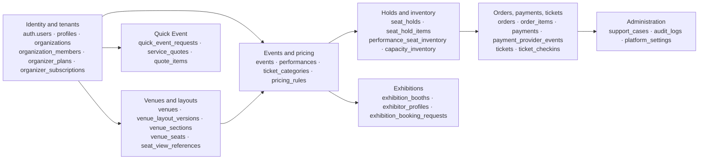
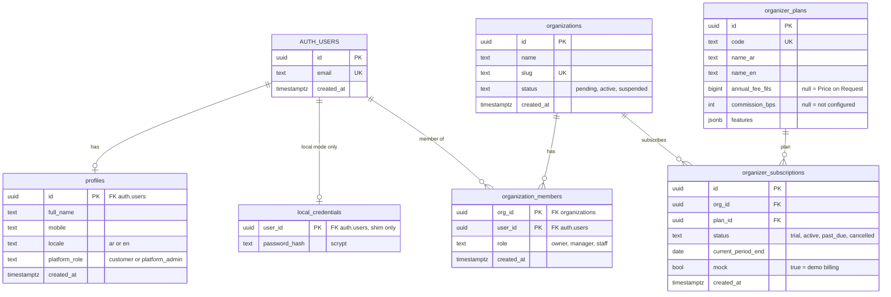
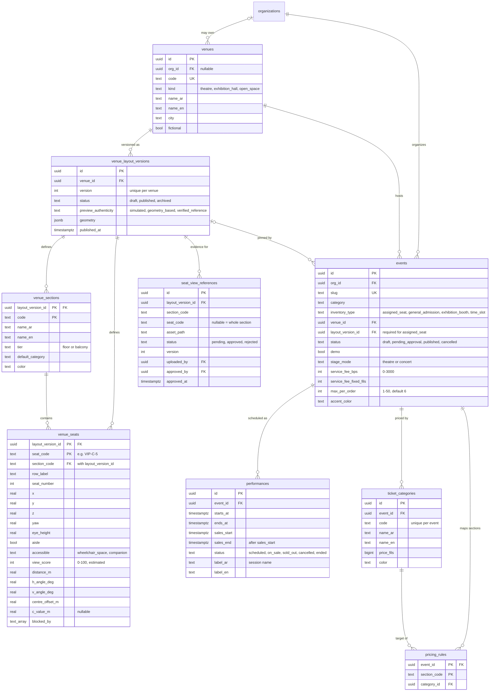
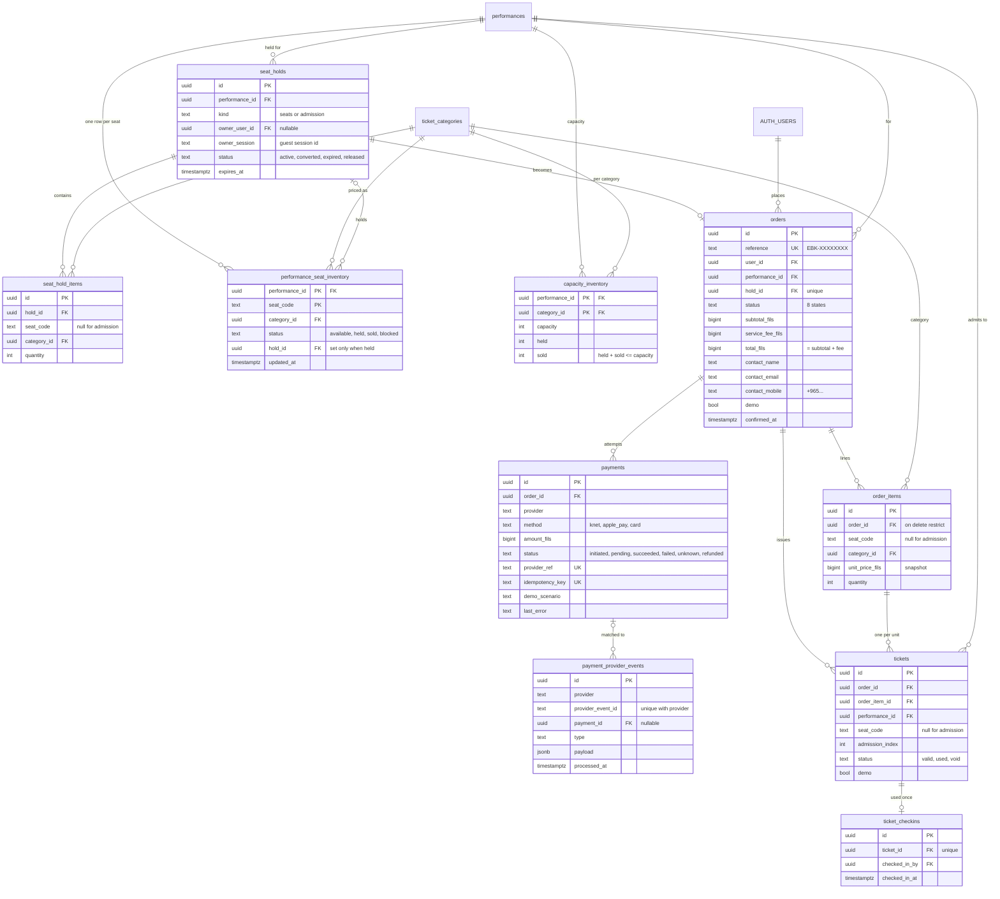
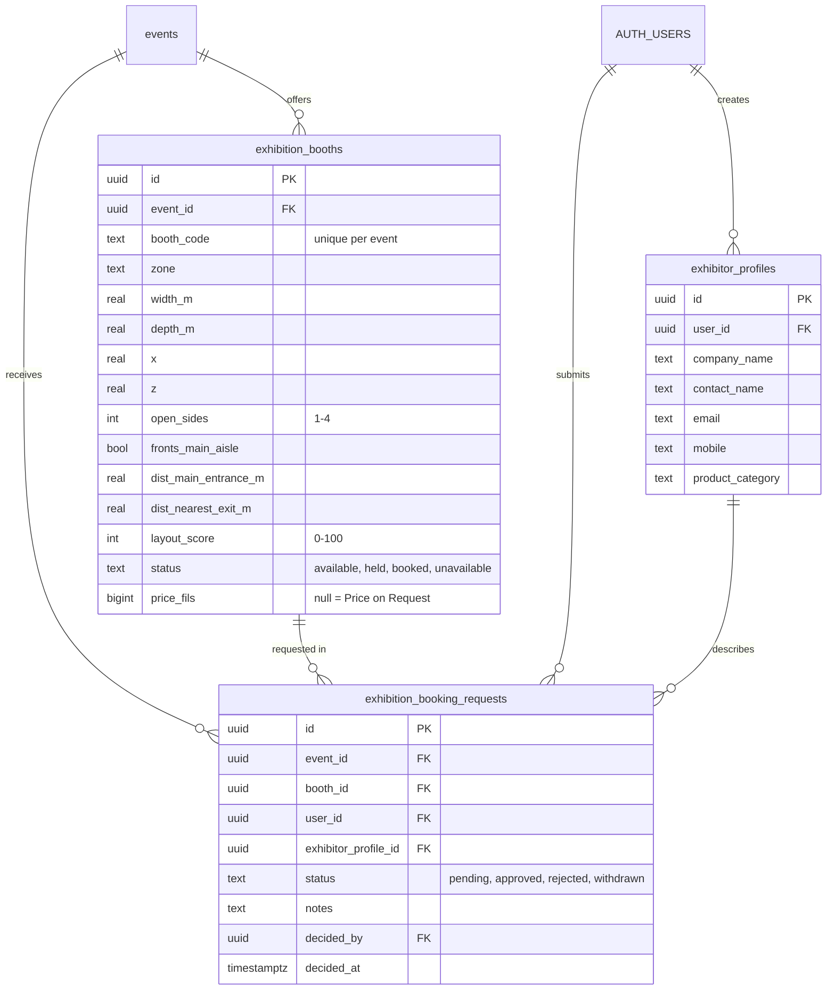
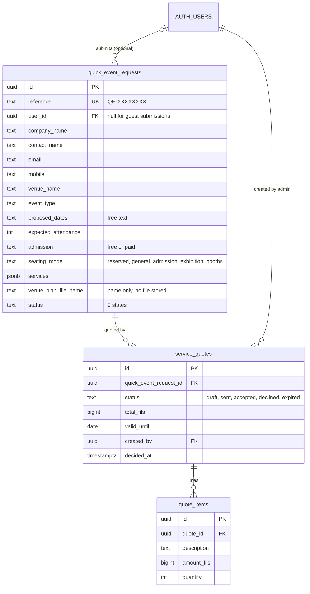
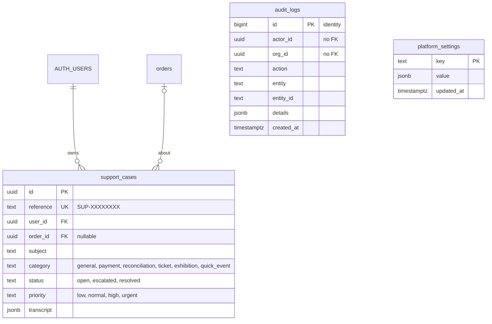

# Ebooking Ticket — Entity Relationship Model (ERD)

> **Source of truth:** `supabase/migrations/0001_core_schema.sql` (tables), `0002_booking_functions.sql` (server functions), `0003_rls.sql` (Row Level Security). Local development adds `supabase/local/0000_local_auth_shim.sql` (PGlite only).
> This document describes the schema **as built** (November 2026). Related: [ARCHITECTURE.md](./ARCHITECTURE.md) · [API-CONTRACTS.md](./API-CONTRACTS.md).

---

## 1. Conventions

| Convention | Rule |
|---|---|
| Schemas | `public` — all application tables (33). `app` — `SECURITY DEFINER` functions. `auth` — Supabase Auth (or the local shim). `local_meta` — migration bookkeeping of the API's runner |
| Keys | `uuid` primary keys (`gen_random_uuid()`), except natural/composite keys (seats, sections, inventory, memberships, settings) and the `audit_logs` identity column |
| Money | Integer **fils** in `bigint` columns with `>= 0` checks (1 KWD = 1000 fils). Percentages as integer basis points (`*_bps`) |
| Enumerations | `text` columns with `CHECK (… in (…))` — no Postgres enum types |
| Bilingual content | Paired `*_ar` / `*_en` columns |
| Time | `timestamptz` (displayed in `Asia/Kuwait`); `date` for subscription period ends and quote validity |
| Nullable price | `null` price = **Price on Request** (plans, commissions, booths) — never a hard-coded placeholder |
| Security | RLS **enabled on every public table**; clients have **no** INSERT/UPDATE/DELETE privileges; all writes go through the API's server connection or `app.*` functions |
| Demo marking | `demo` booleans on events, orders and tickets; `fictional` on venues; `mock` on subscriptions; `preview_authenticity` on layout versions |

Entity names in the diagrams use the table names; `AUTH_USERS` stands for `auth.users`. Attribute types are simplified (`text_array` = `text[]`).

---

## 2. Domain overview

---

## 3. Entity relationship diagrams

### 3.1 Identity, organizations and SaaS plans

### 3.2 Venues, layout versions and events

### 3.3 Holds, inventory, orders, payments and tickets

`performance_seat_inventory.seat_code` and `tickets.seat_code` are **not** foreign keys: they join to `venue_seats.seat_code` through the event's `layout_version_id`.

### 3.4 Exhibitions

### 3.5 Quick Event and quotes

### 3.6 Administration

---

## 4. Key constraints and invariants

| Invariant | Mechanism (exact name where it exists) | Why |
|---|---|---|
| A reserved seat has at most **one live ticket** per performance | Partial unique index **`tickets_one_live_ticket_per_seat`** on `tickets (performance_id, seat_code) WHERE seat_code IS NOT NULL AND status <> 'void'` | Last line of defence against double sale, even if application logic failed |
| At most **one successful payment** per order | Partial unique index **`payments_one_success_per_order`** on `payments (order_id) WHERE status = 'succeeded'` | A second success is a duplicate charge to escalate and refund — never more tickets |
| An exclusive booth is approved for **one exhibitor only** | Partial unique index **`booth_one_approved`** on `exhibition_booking_requests (booth_id) WHERE status = 'approved'` (API maps the violation to `409 booth_already_allocated`) | No double allocation under concurrent approvals |
| One pending request per user per booth | Partial unique index **`booth_one_pending_per_user`** on `(booth_id, user_id) WHERE status = 'pending'` → `409 request_already_pending` | Prevents request spam |
| Capacity can never be oversold | `CHECK (held + sold <= capacity)` on **`capacity_inventory`**, plus non-negative checks on each counter | DB rejects any over-allocation |
| A held seat always points to its hold, and only held seats do | `CHECK ((status = 'held') = (hold_id IS NOT NULL))` on `performance_seat_inventory` | No orphaned or anonymous holds |
| Every hold has an owner | `CHECK (owner_user_id IS NOT NULL OR owner_session IS NOT NULL)` on `seat_holds` | Holds are always attributable |
| One order per hold | `orders.hold_id` is `NOT NULL UNIQUE` | Retries reuse the same order |
| Order totals add up | `CHECK (total_fils = subtotal_fils + service_fee_fils)` and non-negative amounts | Arithmetic integrity in the database |
| Idempotent payment attempts | `payments.idempotency_key` `UNIQUE NOT NULL`; `payments.provider_ref` `UNIQUE` | Same key ⇒ same attempt; no double charge by retry |
| Idempotent webhook processing | `UNIQUE (provider, provider_event_id)` on `payment_provider_events` (`ON CONFLICT DO NOTHING`) | Duplicate deliveries are ignored |
| One ticket per unit of an order line | `UNIQUE (order_item_id, admission_index)` on `tickets` | Exactly-once issuance per seat/admission |
| A ticket is checked in once | `ticket_checkins.ticket_id` `UNIQUE` + atomic `UPDATE … WHERE status = 'valid'` in `app.check_in_ticket` | No re-entry with the same ticket |
| Assigned-seat events reference a layout version | `CHECK (inventory_type <> 'assigned_seat' OR layout_version_id IS NOT NULL)` on `events` | Seats are always tied to a concrete geometry version |
| …and that version is **published** | **Not enforced in the database** — guaranteed only by seed data and the absence of any API that pins a draft. Layout versions are immutable by convention (no update path exists) | Known gap; add a trigger or a composite FK on `(id, status)` when layout editing arrives |
| Seats are unique within a layout version | PK `(layout_version_id, seat_code)` + `UNIQUE (layout_version_id, section_code, row_label, seat_number)` + FK to `venue_sections` | Stable seat identity per version |
| One layout version number per venue | `UNIQUE (venue_id, version)` on `venue_layout_versions` | Versioning |
| **Order item prices are immutable snapshots** | `order_items.unit_price_fils` is written once at order creation; no code path updates it; clients cannot write; `ON DELETE RESTRICT` from `orders`. Price changes only touch `ticket_categories` and are audited | Existing orders keep the price the customer agreed to. **Caveat:** not enforced by a trigger, and a checkout retry after a failed payment re-prices the *order totals* without touching the items (see ARCHITECTURE §19 #5) |
| One open quote per Quick Event request | Partial unique index **`one_open_quote_per_request`** `WHERE status IN ('sent','accepted')`; a new quote first expires the open one | A requester always sees one actionable quote |
| One open reconciliation case per order | Partial unique index **`one_open_reconciliation_case_per_order`** `WHERE category = 'reconciliation' AND status <> 'resolved'` (`ON CONFLICT DO NOTHING`) | Retries never spam cases |
| One live subscription per organization | Unique index on `organizer_subscriptions (org_id) WHERE status IN ('trial','active','past_due')` | Unambiguous plan |
| Approved photo references name their approver | `CHECK (status <> 'approved' OR (approved_by IS NOT NULL AND approved_at IS NOT NULL))` on `seat_view_references` | Human approval is recorded |
| Sales windows are valid | `CHECK (sales_end > sales_start)` on `performances` (the API validates start times first to return `400` instead of a constraint error) | |
| Value ranges | `service_fee_bps` 0–3000, `max_per_order` 1–50, `commission_bps` 0–10000, `view_score` / `layout_score` 0–100, `open_sides` 1–4, positive booth dimensions, positive quantities and attendance | Guard against bad configuration |

---

## 5. Table reference

"Written by" lists the code paths that insert or update rows. "Read access (RLS)" summarises `0003_rls.sql`; the API additionally authorizes every request.

### 5.1 Identity, organizations and SaaS

| Table | Purpose | Notable columns and constraints | Written by | Read access (RLS) |
|---|---|---|---|---|
| `auth.users` | Identity (Supabase Auth, or the local shim) | `id`, unique `email` | Local register/seed (`createLocalUser`); Supabase Auth in hosted mode | Not exposed by the API except emails in org staff lists and admin views |
| `auth.local_credentials` | Local-mode password hashes (**shim only**) | `password_hash` = `scrypt$salt$hash` | `createLocalUser` | n/a |
| `profiles` | Display name, mobile, locale, **platform role** | PK = FK `auth.users` (cascade); `platform_role` ∈ customer, platform_admin | `createLocalUser` (no trigger exists for Supabase-created users) | Own row or platform admin |
| `organizations` | Tenants | unique `slug`; `status` ∈ pending, active, suspended (not yet enforced by the API) | Seed only | Members of the org, platform admin |
| `organization_members` | Membership and role | PK `(org_id, user_id)`; `role` ∈ owner, manager, staff; index on `user_id` | Seed; `POST /api/org/:orgId/staff` (owner; upsert that never changes an owner) | Own memberships, owner/manager of that org, admin |
| `organizer_plans` | SaaS plans | unique `code`; `annual_fee_fils` and `commission_bps` nullable (*Price on Request* / not configured); `features` jsonb (descriptive, not enforced) | Seed (`starter`, `pro`, `enterprise`, all prices null) | Everyone |
| `organizer_subscriptions` | An organization's plan | `status` ∈ trial, active, past_due, cancelled; `current_period_end`; `mock` default true; one live subscription per org | Seed | Owner/manager of the org, admin |

### 5.2 Venues and layouts

| Table | Purpose | Notable columns and constraints | Written by | Read access (RLS) |
|---|---|---|---|---|
| `venues` | A physical place, separate from anything sellable | unique `code`; `kind` ∈ theatre, exhibition_hall, open_space; `fictional` default true; `org_id` nullable | Seed (`GULF-PEARL-DEMO`, `DEMO-COMMUNITY-HALL`, `DEMO-EXPO-HALL`) | Everyone |
| `venue_layout_versions` | Immutable geometry snapshot of a venue | unique `(venue_id, version)`; `status` ∈ draft, published, archived; `preview_authenticity` ∈ simulated, geometry_based, verified_reference; `geometry` jsonb (theatre: stage, arcCenter, obstacles, bounds; hall: hall, entrances, exits, mainAisles) | Seed (version 1, published, simulated) | Published versions; admins; owner/manager of the venue's org |
| `venue_sections` | Sections of a layout version | PK `(layout_version_id, code)`; `tier` ∈ floor, balcony; `default_category`; `color` | Seed | Whenever the layout version is visible |
| `venue_seats` | Seats with geometry and **precomputed SeatVision metrics** | PK `(layout_version_id, seat_code)`; unique section/row/number; FK to section; `x,y,z,yaw,eye_height`; `aisle`; `accessible`; `view_score` 0–100, `distance_m`, `h_angle_deg`, `v_angle_deg`, `centre_offset_m`, `c_value_m`, `blocked_by` | Seed (metrics from `@ebooking/seatvision`) | Whenever the layout version is visible |
| `seat_view_references` | Human-approved photo evidence per section/seat — **FUTURE ingestion** | `status` ∈ pending, approved, rejected; `version`; approval CHECK | Nothing writes it yet | Approved rows; admins see all |

### 5.3 Events and pricing

| Table | Purpose | Notable columns and constraints | Written by | Read access (RLS) |
|---|---|---|---|---|
| `events` | A sellable event | unique `slug`; `category` (7 values); `inventory_type` (4 values); bilingual title/description/policies/accessibility; `status` ∈ draft, pending_approval, published, cancelled; `demo`; `stage_mode`; `service_fee_bps` 0–3000; `service_fee_fixed_fils`; `max_per_order` 1–50 (default 6); `accent_color`; assigned-seat ⇒ layout version; indexes `(org_id)`, `(status, category)` | Seed; organizer create (GA/time-slot only, always `pending_approval`, `demo = true`, fee 200 bps + 250 fils hard-coded); organizer patch (titles, descriptions, `service_fee_bps`); organizer submit (draft → pending); admin decision (pending → published/draft) | Published; any member of the org; admin |
| `performances` | A dated occurrence (show, session, expo days) | `starts_at`, `ends_at`, `sales_start` (default now), `sales_end` > `sales_start`; `status` default `on_sale` (other values unused by code); `label_ar/en` for session names; index `(event_id, starts_at)` | Seed; organizer create (one performance, sales end = start) | When the event is visible |
| `ticket_categories` | Event-level price per category | unique `(event_id, code)`; `price_fils`; `color` | Seed (VIP/PREMIUM/STANDARD/ECONOMY, GA, SEAT); organizer create (`GA`); organizer price change (audited) | When the event is visible |
| `pricing_rules` | Section → category mapping per event | PK `(event_id, section_code)` | Seed only — **not read at runtime**; the live category of a seat is `performance_seat_inventory.category_id` | When the event is visible |

### 5.4 Holds and inventory

| Table | Purpose | Notable columns and constraints | Written by | Read access (RLS) |
|---|---|---|---|---|
| `seat_holds` | Temporary reservation (basket) | `kind` ∈ seats, admission; owner = user and/or guest session; `status` ∈ active, converted, expired, released; `expires_at`; indexes `(status, expires_at)`, `(performance_id, owner_session)` | `app.hold_seats`, `app.hold_admission`, `app._release_hold`, `app.confirm_order` (converted), checkout (claims the hold for the user, extends expiry) | Own (by user id) or admin — guest holds are served by the API after an owner check |
| `seat_hold_items` | Lines of a hold | `seat_code` (null for admission), `category_id`, `quantity`; unique `(hold_id, seat_code)` | Hold functions | When the hold is visible |
| `performance_seat_inventory` | Live state of every seat for a performance | PK `(performance_id, seat_code)`; `status` ∈ available, held, sold, blocked; `hold_id` iff held; index `(hold_id)` | Seed (all available; two blocked); hold, release, confirm functions; refund (sold → available when no live ticket remains) | When the performance is visible (public availability) |
| `capacity_inventory` | Counters for general admission / time slots | PK `(performance_id, category_id)`; `held + sold ≤ capacity` | Seed; organizer create; `app.hold_admission`, `app._release_hold`, `app.confirm_order` (refunds do **not** decrement `sold`) | When the performance is visible |

### 5.5 Orders, payments and tickets

| Table | Purpose | Notable columns and constraints | Written by | Read access (RLS) |
|---|---|---|---|---|
| `orders` | A customer's purchase for one performance | unique `reference` (`EBK-` + 8 chars without I/O/0/1); unique `hold_id`; `status` (8 values, §6); totals in fils with sum check; contact name/email/mobile; `demo`; `confirmed_at`; indexes `(user_id, created_at desc)`, `(performance_id)` | Checkout; `applyPaymentResult`; `app.confirm_order`; `app._release_hold` (expiry); refund; seed (pre-sold demo orders `EBK-SEED0001…`) | The customer; **owner/manager** of the organizing org (**not staff**); admin |
| `order_items` | Order lines with the **unit-price snapshot** | `seat_code` (null for admission), `category_id`, `unit_price_fils`, `quantity`; unique `(order_id, seat_code)`; `ON DELETE RESTRICT` | Checkout (once) | When the order is visible |
| `payments` | Payment attempts | `provider`, `method` ∈ knet, apple_pay, card; `amount_fils`; `status` (6 values); unique `provider_ref`; unique `idempotency_key`; `demo_scenario`; `last_error`; one success per order | Checkout; `applyPaymentResult`; reconciliation; refund | When the order is visible |
| `payment_provider_events` | Inbox of verified provider webhooks | unique `(provider, provider_event_id)`; raw `payload`; `payment_id`; `processed_at` | `handleWebhook` (only after the signature verifies) | Platform admin only |
| `tickets` | Right of entry, one per seat or admission | `seat_code` / `admission_index`; `status` ∈ valid, used, void; `demo`; live-ticket-per-seat index; unique `(order_item_id, admission_index)` | `app.confirm_order` (issue); `app.check_in_ticket` (used); refund (void) | The customer; **any** member of the organizing org (staff need tickets for check-in); admin |
| `ticket_checkins` | Check-in record | unique `ticket_id`; `checked_in_by`; `checked_in_at` | `app.check_in_ticket` | When the ticket is visible |

### 5.6 Exhibitions

| Table | Purpose | Notable columns and constraints | Written by | Read access (RLS) |
|---|---|---|---|---|
| `exhibition_booths` | Bookable booths of an exhibition event | unique `(event_id, booth_code)`; size, centre `x/z`, `open_sides`, `fronts_main_aisle`, distances, `layout_score`; `status` ∈ available, held (unused), booked, unavailable; nullable `price_fils` | Seed (24 booths, prices null); organizer patch (price, available/unavailable); approval (booked) | When the event is visible |
| `exhibitor_profiles` | Exhibitor company/contact details | one row is created **per request** (not reused) | `POST /api/exhibitions/requests` | Own; admin; owner/manager of an org that received a request with this profile |
| `exhibition_booking_requests` | Booth request and decision | `status` ∈ pending, approved, rejected, withdrawn (withdraw not implemented); `decided_by`, `decided_at`; single-approval and one-pending-per-user indexes | Booth request; organizer decision (approval also auto-rejects other pending requests for the booth) | Own; owner/manager of the event's org; admin |

### 5.7 Quick Event

| Table | Purpose | Notable columns and constraints | Written by | Read access (RLS) |
|---|---|---|---|---|
| `quick_event_requests` | Managed-event request | unique `reference` (`QE-…`); nullable `user_id` (guest); `admission` ∈ free, paid; `seating_mode` ∈ reserved, general_admission, exhibition_booths; `services` jsonb; `venue_plan_file_name` (name only); `status` (9 values) | `POST /api/quick-events`; admin status changes; quote creation (→ quoted); requester decision (→ quote_accepted / quote_declined) | Own (signed-in submitter); admin |
| `service_quotes` | Custom quote | `status` ∈ draft (unused), sent, accepted, declined, expired; `total_fils` = Σ amount × quantity (computed by the API); `valid_until`; `created_by`; one open quote per request | Admin quote builder; requester decision; superseding (sent → expired); late acceptance attempt (→ expired) | When the request is visible |
| `quote_items` | Quote lines | `description`, `amount_fils`, `quantity` | Admin quote builder | When the quote is visible |

### 5.8 Administration

| Table | Purpose | Notable columns and constraints | Written by | Read access (RLS) |
|---|---|---|---|---|
| `support_cases` | Customer support and reconciliation cases | unique `reference` (`SUP-…`); `category` (6 values); `status` ∈ open, escalated, resolved; `priority` ∈ low, normal, high, urgent; `transcript` jsonb; one open reconciliation case per order | Reconciliation (`escalated`, `urgent`); assistant (`open`, payment); admin resolve; refund (auto-resolve) | Own or admin |
| `audit_logs` | Append-only business audit trail | identity `id`; `actor_id`, `org_id` (no FKs); `action`, `entity`, `entity_id`, `details`; index `(org_id, created_at desc)` | `BookingService.audit()` and the assistant; no update/delete path exists | Admin; **owner** of `org_id` |
| `platform_settings` | Key/value platform configuration | `key` PK, `value` jsonb | Seed (`fees` with demo defaults, `demo_mode`) — informational; event creation does not read it | Admin only |

Audit actions currently emitted: `event.created`, `event.updated`, `event.submitted`, `event.approved`, `event.returned_to_draft`, `category.price_changed`, `ticket.checkin`, `booth_request.created`, `booth_request.approved`, `booth_request.rejected`, `booth.updated`, `staff.upserted`, `quick_event.submitted`, `quick_event.status`, `quote.sent`, `quote.accepted`, `quote.declined`, `support.resolved`, `order.confirmed`, `order.reconciliation_required`, `order.refunded`, `payment.duplicate_charge`, `ai.tool_call`.

---

## 6. Status enumerations

| Table.column | Values | Set by code | Notes |
|---|---|---|---|
| `events.status` | draft, pending_approval, published, cancelled | all except `cancelled` | Public catalogue shows `published` only |
| `performances.status` | scheduled, on_sale, sold_out, cancelled, ended | `on_sale` (default) only | Sales also require `sales_start ≤ now ≤ sales_end` |
| `seat_holds.status` | active, converted, expired, released | all | |
| `performance_seat_inventory.status` | available, held, sold, blocked | all (`blocked` by seed only) | |
| `orders.status` | pending_payment, payment_processing, confirmed, payment_failed, expired, reconciliation_required, cancelled, refunded | all except `cancelled`; `pending_payment` only transiently inside the checkout transaction | State diagram in ARCHITECTURE §8.3 |
| `payments.status` | initiated, pending, succeeded, failed, unknown, refunded | all | ARCHITECTURE §8.4 |
| `tickets.status` | valid, used, void | all | |
| `exhibition_booths.status` | available, held, booked, unavailable | all except `held` | |
| `exhibition_booking_requests.status` | pending, approved, rejected, withdrawn | all except `withdrawn` | |
| `quick_event_requests.status` | submitted, under_review, quoted, quote_accepted, quote_declined, configuring, approved, live, rejected | all | Transitions enforced by `QUICK_EVENT_TRANSITIONS` (PRD §12) |
| `service_quotes.status` | draft, sent, accepted, declined, expired | all except `draft` | |
| `support_cases.status` | open, escalated, resolved | all | |
| `organizer_subscriptions.status` | trial, active, past_due, cancelled | seed: trial, active | Billing is mock |

---

## 7. Server functions (`app` schema)

All are `SECURITY DEFINER` with `search_path = public, pg_temp` (tested). Booking functions are revoked from `PUBLIC`; the four RLS helpers are granted to `anon` and `authenticated`.

| Function | Purpose | Locking | Result / errors |
|---|---|---|---|
| `app.is_platform_admin()` | RLS helper: current user is platform admin | — | boolean |
| `app.is_org_member(org, roles[])` | RLS helper: membership with one of the roles | — | boolean |
| `app.performance_org(performance)` / `app.event_org(event)` | Organization owning a performance/event (also used by API queries) | — | uuid |
| `app._assert_on_sale(performance, inventory_type)` | Event published, performance on sale, inside the sales window, right inventory type | — | raises `performance_not_found`, `wrong_inventory_type`, `not_on_sale` |
| `app.hold_seats(performance, seats[], user, session, ttl, max)` | Atomic all-or-nothing seat hold, replacing the owner's basket | `FOR UPDATE` on requested seats ordered by `seat_code` | hold id; raises `no_seats`, `too_many_seats`, `duplicate_seats`, `no_owner`, `unknown_seat`, `seat_unavailable:<codes>` |
| `app.hold_admission(performance, category, qty, user, session, ttl, max, type)` | Atomic capacity hold | `FOR UPDATE` on the capacity row | hold id; raises `invalid_quantity`, `no_owner`, `unknown_category`, `capacity_exceeded` |
| `app.release_expired_holds(performance?)` | Expire active holds past `expires_at` | `FOR UPDATE SKIP LOCKED` | number released |
| `app._release_hold(hold, new_status)` | Free seats and held capacity, set hold status, expire orders still `pending_payment`/`payment_failed` | `FOR UPDATE` on the hold | — |
| `app._release_owner_holds(performance, user, session)` | Release the owner's previous active holds unless their order is paying/confirmed/under reconciliation | `FOR UPDATE` | — |
| `app.confirm_order(order)` | Allocate inventory and issue tickets exactly once after a succeeded payment | `FOR UPDATE` on order, hold, every seat/capacity row | `confirmed`, `already_confirmed`, `not_confirmable`, `payment_not_verified`, `reconciliation_required` |
| `app.check_in_ticket(ticket, staff)` | Atomic single-use check-in | conditional `UPDATE … WHERE status = 'valid'` | `checked_in`, `already_used`, `void`, `not_found` |

---

## 8. Row Level Security summary

No INSERT/UPDATE/DELETE policies exist and those privileges are revoked from `anon` and `authenticated`, so every client-side write is denied. SELECT policies:

| Table(s) | Readable by |
|---|---|
| `profiles` | Self, admin |
| `organizations` | Members (any role), admin |
| `organization_members` | Self, owner/manager of that org, admin |
| `organizer_plans`, `venues` | Everyone |
| `organizer_subscriptions` | Owner/manager, admin |
| `venue_layout_versions` | Published; admin; owner/manager of the venue's org |
| `venue_sections`, `venue_seats` | When the parent layout version is visible |
| `seat_view_references` | Approved rows; admin |
| `events` | Published; members (any role); admin |
| `performances`, `ticket_categories`, `pricing_rules`, `exhibition_booths` | When the parent event is visible |
| `performance_seat_inventory`, `capacity_inventory` | When the parent performance is visible |
| `seat_holds` | Owner user, admin; `seat_hold_items` follow the hold |
| `orders` | Customer, owner/manager of the organizing org, admin; `order_items` and `payments` follow the order |
| `payment_provider_events` | Admin |
| `tickets` | Customer, any member of the organizing org (incl. staff), admin; `ticket_checkins` follow the ticket |
| `exhibition_booking_requests` | Requester, owner/manager of the event's org, admin |
| `exhibitor_profiles` | Owner user, admin, owner/manager of an org that received a request with that profile |
| `quick_event_requests` | Requester (signed-in), admin; `service_quotes` and `quote_items` follow the request |
| `support_cases` | Owner user, admin |
| `audit_logs` | Admin; owner of the row's `org_id` |
| `platform_settings` | Admin |

---

## 9. Seeded demo data (fictional)

| Entity | Seeded content |
|---|---|
| Users | 7 demo accounts (customer, Gulf Stage owner/manager/staff, Desert Lights owner, platform admin, synthetic demo buyers) |
| Organizations | *Gulf Stage Productions (Demo)*, *Desert Lights Events (Demo)* with trial/active `pro` subscriptions (`mock`) |
| Plans | `starter`, `pro`, `enterprise` — every price `null` |
| Venues | *Gulf Pearl Demo Theatre* (444 seats, 8 sections, layout v1 published, simulated), *Demo Community Hall*, *Demo Exhibition Hall* (layout v1, simulated) |
| Events | 2 assigned-seat (theatre + concert staging), 1 general admission, 1 time-slot workshop (other tenant), 1 exhibition (24 booths, 3 booked, 1 unavailable) |
| Sales | 22–31 random seat groups attempted per theatre performance through the real `hold_seats` and `confirm_order` functions; overlapping groups fail exactly as the invariant requires (orders `EBK-SEED…`, owned by the demo-buyers account, `demo_scenario = 'seed'`) |
| Settings | `fees` (demo defaults), `demo_mode = true` |

---

## 10. Deferred entities

### 10.1 Named in the original specification brief — intentionally not built yet

| Entity | Intended purpose | Status in the MVP |
|---|---|---|
| `organizer_payout_records` | Settlement of ticket revenue to organizers per period (gross, refunds, commission, net, payout reference, status) | **Not built.** The organizer dashboard computes gross/refunds/commission/net on the fly from `orders`; no payout or statement is recorded |
| `notification_records` | Outbound email/SMS/push messages (template, recipient, channel, delivery status, provider id) for confirmations, reminders and quote updates | **Not built.** No notifications are sent |
| `pricing_rules` **beyond section → category mapping** | Time-based price changes, promo codes, discounts, per-seat overrides, dynamic pricing | **Not built.** The existing `pricing_rules` table is only a section → category map (seeded, not read at runtime); prices live on `ticket_categories` |

### 10.2 Other entities the roadmap will need (candidates, not yet specified)

| Candidate | Why it is needed |
|---|---|
| SaaS invoices / billing events | Subscriptions are mock; no invoices or charges exist |
| Refund records (partial / multiple refunds) | Today a refund is a status change on `payments` and `orders` (full amount only) |
| Booth payments, deposits and exhibitor contracts | Booth requests end at approval |
| File objects (Quick Event venue plans, seat-view photos) | Only `venue_plan_file_name` and `seat_view_references.asset_path` strings exist; no storage |
| Organization invitations | Staff can only be added if they already have an account |
| Organization onboarding / KYC | Organizations exist only through seed data |
| Event/performance cancellation and bulk-refund jobs | `cancelled` statuses exist but nothing sets them |
| Ticket transfers | Not built |
| Waiting-room / queue tokens | Not built (ARCHITECTURE §12) |
| Consent records and data-subject requests | Privacy programme (SECURITY.md §6) |
| Per-event staff assignment and gate/device registry | Staff access is organization-wide today |
