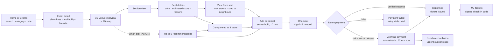
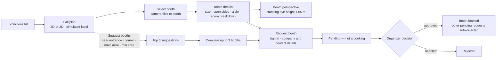
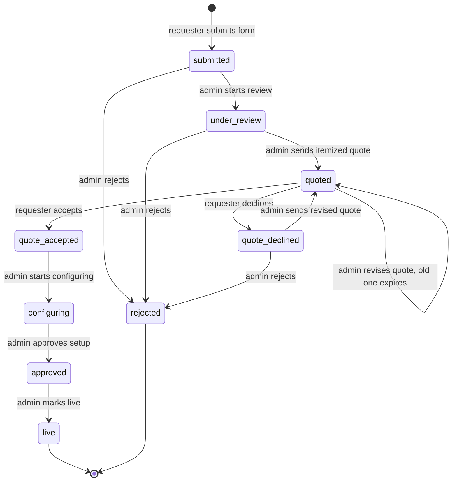

# Ebooking Ticket — Product Requirements Document (PRD)

> **Status:** MVP built — **demo build** (version 0.1.0, November 2026).
> Every venue, organizer, event, order, payment and ticket in this build is **fictional**. No real payment is processed and demo tickets are **not valid for entry**. No commercial price, fee or commission has been approved yet: anything commercial shows as **Price on Request** (السعر عند الطلب). No partnership with any venue, mall or operator exists or is implied.
>
> Companion documents: [ARCHITECTURE.md](./ARCHITECTURE.md) · [ERD.md](./ERD.md) · [API-CONTRACTS.md](./API-CONTRACTS.md) · [DESIGN-SYSTEM.md](./DESIGN-SYSTEM.md) · [SECURITY.md](./SECURITY.md) · [TEST-PLAN.md](./TEST-PLAN.md)

---

## 1. Vision

> **See your view. Choose your seat. Book with confidence.**
> **شوف إطلالتك. اختر كرسيك. احجز بثقة.**

Ebooking Ticket is a **Kuwait-first, Arabic-first** ticketing and space-booking platform:

- **B2C:** people discover events, *sit virtually in a seat* before paying, and book with a server-guaranteed hold and transparent fees.
- **B2B SaaS:** organizers and venue operators get inventory that cannot be double-sold, payment recovery that never double-charges, least-privilege team roles and an audit trail.
- **Managed service:** *Quick Event* gives malls, pop-up and community operators a quote-based path to run a temporary event without onboarding to the full SaaS first.

### 1.1 Product pillars

| Pillar | What it is | MVP state |
|---|---|---|
| **Ebooking SeatVision AI** | 3D venue with a seated-eye perspective from every seat, a transparent geometric view score, natural-language "smart pick" (Arabic incl. Kuwaiti dialect, and English), side-by-side comparison | ✅ Built on a **simulated, fictional** theatre |
| **SpaceVision** | 3D/2D exhibition hall plan, booth scores from measurable layout facts, booth perspective, booth request → organizer approval | ✅ Built on a **simulated, fictional** hall |
| **Ebooking Quick Event** | Managed, quote-based service for temporary events (submit → review → custom quote → accept → configure → approve → live) | ✅ Pipeline + quotes built; actual event configuration is a **manual** step |
| **Booking core** | Atomic holds, server pricing, payments (demo gateway), reconciliation, tickets, check-in | ✅ Built (demo gateway only) |
| **Organizer portal** | Dashboard, events, pricing, bookings, seat inventory, check-in, exhibitors, staff, subscription, audit | ✅ Built (event creation limited to general admission / time slots) |
| **Platform admin** | Overview, event approvals, Quick Event pipeline + quote builder, support & reconciliation, audit | ✅ Built |
| **Booking Recovery Assistant** | Support chat that explains *verified* order/payment status and opens cases | ✅ Built (deterministic; no LLM involved) |

> **About the "AI" in SeatVision AI.** In the MVP the seat intelligence is *deterministic*: geometric scoring (`packages/seatvision/src/scoring.ts`) and a rule-based Arabic/English intent parser (`packages/seatvision/src/intent.ts`). A large language model is an **optional fallback for parsing a request only** (disabled by default, `AI_PROVIDER=none`); it never creates seats, prices or availability.

---

## 2. Audiences

| Audience | Who | Role(s) in the product | Notes |
|---|---|---|---|
| **B2C attendees** | People in Kuwait booking theatre, concerts, comedy, workshops, conferences and family events | *Guest*, *Registered Customer* | Arabic is the default UI language; English is one click away |
| **B2B organizers / venue operators** | Production companies, event organizers, venue teams | *Organizer Owner*, *Organizer Manager*, *Event Staff* | Multi-tenant: an organization only ever sees its own data |
| **Exhibition organizers** | Organizers running expos/bazaars with booths | Same organizer roles | Manage booth prices, availability and requests |
| **Exhibitors** | Small businesses requesting a booth | A *Registered Customer* making booth requests | No separate account type |
| **Quick Event customers** (target segments) | Mall and retail-complex operators, pop-up market organizers, community organizers, workshop operators | Guest or Registered Customer submitting a request | **Segments only — no partnership exists or is implied** |
| **Platform super admin** | The Ebooking operations team | *Platform Administrator* | Approves events, runs Quick Event and reconciliation |

Demo personas (fictional, seeded by `apps/api/src/seed.ts`): one customer, the owner / manager / gate staff of *Gulf Stage Productions (Demo)*, the owner of a second tenant *Desert Lights Events (Demo)* (used to prove tenant isolation), a platform admin, and a synthetic "demo buyers" account that owns the pre-sold seats. Credentials are local test values — see the README.

---

## 3. Problems we are solving

These are **product hypotheses** that shaped the MVP; they still need validation with user research in Kuwait.

### 3.1 Customer problems

| # | Problem | MVP answer |
|---|---|---|
| C1 | A flat seat map does not tell you what you will actually *see* (distance, angle, obstructions, heads in front) | Seated-eye 3D perspective per seat + explained, *estimated* view score |
| C2 | Groups need seats that are genuinely side by side, within a total budget | Smart pick returns only consecutive, currently available seats in one row whose total fits the budget |
| C3 | "Money was taken but no ticket arrived" and fear of being charged twice on retry | Idempotent payments, in-flight lock, verified webhooks, reconciliation, and an assistant that explains the *verified* state |
| C4 | Arabic-language experiences often feel translated | Arabic-first RTL UI with Kuwaiti-dialect copy and a dialect-aware request parser |
| C5 | Fees appear late in the funnel | Fee rule shown on the event page; server-computed fee shown in the basket and checkout before paying |
| C6 | Accessibility needs (wheelchair spaces, non-3D devices, keyboard / screen-reader users) | Accessible 2D seat map with full booking capability; wheelchair-space flags (demo data); keyboard navigation; reduced motion |

### 3.2 Organizer problems

| # | Problem | MVP answer |
|---|---|---|
| O1 | Double-selling under concurrent demand | Database-level atomic holds + partial unique indexes |
| O2 | Gateway timeouts leave payments in limbo | `unknown` payment state, background reconciliation, `reconciliation_required` orders with urgent support cases |
| O3 | Tenant confidentiality and least-privilege staff access | Per-route role checks + PostgreSQL Row Level Security; staff limited to check-in |
| O4 | Booth allocation by phone/spreadsheet causes disputes | Request → approval workflow with a single-approval database guarantee |
| O5 | Temporary events need fast setup | Quick Event managed pipeline with custom quotes |
| O6 | Ticket re-use at the gate | Server-signed check-in codes with atomic single use |
| O7 | Changing prices must not corrupt existing orders | Event-level prices; order lines keep their own unit-price snapshot; every change audited |

---

## 4. Competitive differentiation

Framed against *typical 2D seat-map ticketing flows*; no competitor is named and no market data is claimed.

| Differentiator | Detail |
|---|---|
| **SeatVision AI — see before you pay** | Camera placed at seated eye height (seat position + 1.15 m) in the exact seat, aimed at the stage focus; look around, step to adjacent seats or rows, compare up to three seats in one view |
| **Transparent, honest scoring** | Distance, horizontal/vertical angle, centre offset, obstruction (incl. C-value) and tier, combined with **published weights**; always labelled *estimated*; every preview carries an authenticity label (*simulated* / *geometry-based* / *verified reference*) |
| **Smart pick in Kuwaiti Arabic** | "أبي ٤ كراسي يم بعض وبالنص بميزانية ١٠٠ دينار" → genuinely adjacent, available seats within budget, with reasons; works with no AI provider at all |
| **SpaceVision for exhibitors** | Booth choice from measurable layout facts (distance to main entrance, open sides, main-aisle frontage, area) — explicitly *not* traffic or sales predictions |
| **Quick Event** | A managed, quote-based service for pop-ups instead of a fixed price list |
| **Trust by construction** | Server-authoritative holds and prices, no double sale, no uncontrolled double charge, payment recovery assistant |

---

## 5. Scope

### 5.1 In scope — built in the MVP

- Public catalogue (search, category and date filters), event detail with showtimes/sessions and live availability counts.
- SeatVision 3D venue (overview → section → seat), mini-map, 360° tour, category filter, quality toggle, slow-device detection, seat comparison, smart pick, accessible 2D map, WebGL loss handling.
- Holds for reserved seats and for capacity-based inventory, basket drawer with countdown, sign-in at checkout, demo payment with five outcome scenarios, order page with live verification, tickets with signed check-in codes, My Bookings, My Tickets.
- Payment reconciliation (sweeper, customer "Check now", admin retry-confirm, admin refund) and the Booking Recovery Assistant.
- SpaceVision exhibition (3D/2D plan, booth details and score breakdown, recommendations, comparison, booth perspective, booth request form).
- Quick Event request form, requester tracking, quote accept/decline; admin pipeline and itemized quote builder.
- Organizer portal and platform admin console (see §10, §11).
- Arabic/English with RTL/LTR switching; responsive desktop/tablet/mobile.

### 5.2 Out of scope for the MVP (explicit exclusions)

| Excluded | Comment |
|---|---|
| Real payment gateways (KNET-compatible, Apple Pay, hosted card) | Abstraction ready; only the deterministic demo simulator exists |
| Real SaaS billing / invoicing | Subscriptions are `mock = true`; no charges, no invoices |
| Approved commercial price list | All plan fees, commissions and booth prices are configurable and shown as *Price on Request* until approved |
| Organizer self-service onboarding | Organizations exist only via seed data; no sign-up API |
| Venue / layout editor; creating assigned-seat or exhibition events from the portal | Organizers can create **general admission** and **time-slot** events only |
| Seat blocking / holds management by organizers | Blocked seats exist only in seed data |
| Event or performance cancellation, customer cancellation, partial refunds, ticket transfer, resale | Not built |
| Booth payments, contracts or deposits | Booth requests end at organizer approval |
| Notifications (email, SMS, WhatsApp, push) | Not built |
| File storage (Quick Event venue plans, seat-view photos) | Only the file **name** is sent today |
| Computer-vision ingestion of venue photos | Future work — see ARCHITECTURE §11 |
| Waiting room / queueing for high-demand on-sales | Not built (see ARCHITECTURE §12) |
| Organizer payouts / settlements | Not built (dashboard shows computed net only) |
| Native mobile apps | Responsive web only (a web app manifest exists) |
| MFA, password reset (local auth) | Expected from Supabase Auth in hosted mode |

---

## 6. Inventory types

Each inventory type has its own rules; seat assumptions are **not** reused everywhere (`packages/shared/src/domain.ts`).

| Inventory type | Stored as | Purchase unit | Per-order limit | How it is held | Demo example |
|---|---|---|---|---|---|
| **Assigned seats** (`assigned_seat`) | One `performance_seat_inventory` row per seat per performance | An individual seat | **6 seats** — enforced in the request schema (`HoldSeatsBody` max 6), in the service (`MAX_SEATS_PER_ORDER`) and in SQL (`app.hold_seats` with `min(event.max_per_order, 6)`) | `app.hold_seats` — row locks in seat-code order, all-or-nothing | *Mubarakiya Nights* (theatre staging), *Echoes of the Gulf* (concert staging) |
| **General admission** (`general_admission`) | `capacity_inventory` (capacity / held / sold) per performance and category | A quantity | The event's `max_per_order` (database default 6, allowed 1–50), additionally capped at **10** by the API schema (`HoldAdmissionBody`) | `app.hold_admission` — locks the capacity row; `held + sold ≤ capacity` | *Diwaniya Laughs* (limit 10, 150 places per performance) |
| **Time-slot sessions** (`time_slot`) | Each session is a `performances` row (with an optional label, e.g. "Morning session") + `capacity_inventory` | A quantity for one session | Same as general admission | Same as general admission | *Arabic Calligraphy for Beginners* (limit 4, 20 places per session) |
| **Exhibition booths** (`exhibition_booth`) | `exhibition_booths` + `exhibition_booking_requests` | One booth per request | Not cart-based | No hold: **request → organizer approval**; at most one approved request per booth (DB index) | *Small Business Expo* (24 booths, all *Price on Request*) |

> **The 6-seat limit applies only to reserved theatre seats.** General admission and time-slot sessions use the event's own limit (≤ 10 through the API); booths are allocated one per request by approval. The smart-pick parser also caps a requested group at 6 because it only recommends reserved seats.

Fictional demo layouts (generator parameters, **not** measurements of any real venue): the *Gulf Pearl Demo Theatre* has 444 seats in 8 sections (floor VIP, Premium Centre/Left/Right, Standard Centre/Left/Right, and a 3-row balcony), two demo wheelchair spaces with companion seats, and two seats blocked for a fictional camera platform; the *Demo Exhibition Hall* has 24 booths of 4 m × 3 m.

---

## 7. User roles and least-privilege permissions

### 7.1 Roles

| Role | How it is established | Scope |
|---|---|---|
| **Guest** | No token; an anonymous random session id (`x-session-id`, stored per tab) identifies hold ownership only | Browse; hold seats/admission; submit a Quick Event request (unlinked to an account) |
| **Registered Customer** | Verified JWT; `profiles.platform_role = 'customer'` | Own orders, tickets, cases, booth requests, Quick Event requests |
| **Exhibitor** | A Registered Customer who submits booth requests (`exhibitor_profiles` row per request) | Own booth requests |
| **Organizer Owner** | `organization_members.role = 'owner'` | Everything in their organization, incl. staff management and the org audit log |
| **Organizer Manager** | `organization_members.role = 'manager'` | Operations and finance of their organization; no staff changes, no audit log |
| **Event Staff** | `organization_members.role = 'staff'` | Event list (read) and check-in only — **no financial or customer data** |
| **Platform Administrator** | `profiles.platform_role = 'platform_admin'` (read from the database, never from the token) | Admin console only; **not** automatically a member of any organization |

Identity always comes from a verified token; the platform role and organization roles are always read from the database (`apps/api/src/auth.ts`).

### 7.2 Permission matrix (API-enforced; RLS mirrors it for reads)

Legend: ✅ allowed · ◐ own records only · — denied.

| Capability | Guest | Customer / Exhibitor | Org Owner | Org Manager | Event Staff | Platform Admin |
|---|---|---|---|---|---|---|
| Browse published events, seat maps, availability, smart pick, exhibitions, booth recommendations | ✅ | ✅ | ✅ | ✅ | ✅ | ✅ |
| Hold seats / admission (basket) | ✅ (session id) | ✅ | ✅ | ✅ | ✅ | ✅ |
| Checkout and pay | — (sign-in required) | ✅ | ✅ | ✅ | ✅ | ✅ |
| Orders, tickets, "Check now" verification | — | ◐ | ◐ | ◐ | ◐ | ◐ |
| Booking Recovery Assistant, support cases | — | ◐ | ◐ | ◐ | ◐ | ◐ |
| Submit booth request; list own requests | — | ◐ | ◐ | ◐ | ◐ | ◐ |
| Submit Quick Event request | ✅ (not linked to an account) | ✅ (linked) | ✅ | ✅ | ✅ | ✅ |
| Track Quick Event requests; accept/decline a quote | — | ◐ (requests submitted while signed in) | ◐ | ◐ | ◐ | ◐ |
| Org dashboard (revenue, refunds, commission, net) and subscription view | — | — | ✅ | ✅ | — | — |
| Org events list | — | — | ✅ | ✅ | ✅ | — |
| Event detail; create GA/time-slot event; edit text and service fee; resubmit a draft | — | — | ✅ | ✅ | — | — |
| Change ticket-category prices | — | — | ✅ | ✅ | — | — |
| Seat inventory; orders list (incl. customer contact name) | — | — | ✅ | ✅ | — | — |
| Ticket check-in | — | — | ✅ | ✅ | ✅ | — |
| Booth requests (incl. exhibitor contact details): view, approve, reject; booth price/availability | — | — | ✅ | ✅ | — | — |
| View team | — | — | ✅ | ✅ | — | — |
| Add / change managers and staff | — | — | ✅ | — | — | — |
| Organization audit log | — | — | ✅ | — | — | — |
| Admin overview, event approvals, Quick Event pipeline and quotes, support cases, retry-confirm, refunds, platform audit | — | — | — | — | — | ✅ |

"Org" capabilities apply only to the organization in the URL and only if the user is a member of it; a member of organization A receives `403` for organization B (tested in `apps/api/src/security.test.ts`).

---

## 8. Customer journeys

### 8.1 Reserved seats (SeatVision)

Key behaviours:

- **No account needed to explore or hold.** Sign-in is requested only at checkout; the hold stays valid while the customer signs in.
- **Basket = one server hold per performance.** Adding or removing a seat sends the full seat list; the server replaces the previous hold atomically (`app.hold_seats`). Moving to another performance releases the previous basket.
- **Hold timer:** `HOLD_TTL_SECONDS` (default 600 s). Once checkout starts, the hold is extended to at least `PAYMENT_WINDOW_SECONDS` (default 900 s) while payment is in flight.
- **Prices are never computed in the browser.** The basket, checkout and order show server-calculated subtotal, service fee and total.
- **3D is never required.** The 2D map offers every booking action and is shown automatically without WebGL.

### 8.2 General admission and time-slot sessions

Event detail → choose a showtime/session → choose quantity (up to the event limit and remaining capacity) → **Book** creates a capacity hold → checkout → same payment and ticket flow. Each admission gets its own ticket (`admission_index` 1..n).

### 8.3 Payment recovery

| Situation | What the customer sees | What the system does |
|---|---|---|
| Provider confirms success | "Your booking is confirmed" + tickets | Confirms exactly once (`app.confirm_order`) |
| Provider confirms failure | "Payment failed" + *Try again* | Seats stay held until expiry; a retry uses a new idempotency key |
| Network drops while paying | "Retry safely" button | The browser reuses the **same** idempotency key, so a retry maps to the same payment attempt |
| Outcome unknown / delayed | "Verifying your payment… do not pay again", auto-refresh every 3 s, *Check now* | Payment `unknown`/`pending`; sweeper and *Check now* ask the provider for the verified status; a second checkout with a new key is refused (`409 payment_in_progress`) |
| Payment verified but seats were lost after the hold expired | "Payment verified — needs reconciliation" + support case number | Order `reconciliation_required`, **no ticket**, urgent support case; admin offers alternatives or refunds after provider verification |

### 8.4 Support

Signed-in users open **Support** to chat with the Booking Recovery Assistant (Arabic or English, answered in the language of the message), look up an order by reference (`EBK-XXXXXXXX`), see their support cases, and read what each payment status means. The assistant can only read the user's own records, ask the provider for a verified status, and open a support case; it cannot issue tickets, change payments or refund.

---

## 9. Exhibitor journey (SpaceVision)

- Booth prices are per booth and may be *Price on Request* (`price_fils` null); the seeded expo uses Price on Request for every booth.
- A user can have only one pending request per booth; a booked or unavailable booth cannot be requested.
- Requests and decisions appear under **My Bookings → Booth requests**.

---

## 10. Organizer journeys

| Journey | Steps | Roles |
|---|---|---|
| **Monitor sales** | Overview: gross sales, refunds, commission (when configured) and net, customer fees, tickets sold and checked in, seat availability, breakdowns by event / category / performance, recent orders | Owner, Manager |
| **Launch a GA or time-slot event** | *Create event* (titles AR/EN, category, capacity, single price, start time ≥ 10 minutes ahead) → status **pending approval** → platform admin publishes or returns it to draft → organizer edits and **resubmits** | Owner, Manager |
| **Change prices** | Pricing tab → edit a category price in KWD (parsed to integer fils) → audited; existing orders keep their unit-price snapshot | Owner, Manager |
| **Adjust event details** | Edit titles, descriptions and the service-fee percentage | Owner, Manager |
| **Inspect inventory** | Seat inventory per performance (status per seat) and capacity per performance | Owner, Manager |
| **Review bookings** | Orders filtered by event and status (latest 200), with seats and customer contact name | Owner, Manager |
| **Run the gate** | Check-in tab: scan (keyboard-wedge scanner) or paste the ticket code → *checked in* / *already used* / *void* / *invalid code* / *not for this organizer*; focus stays in the field for the next scan | Owner, Manager, Staff (staff land here by default) |
| **Allocate booths** | Exhibitors tab: review requests with exhibitor details → approve (books the booth, auto-rejects other pending requests) or reject; set booth price or Price on Request; mark booths available/unavailable | Owner, Manager |
| **Manage the team** | Add an existing account by email as manager or staff (owner role cannot be changed this way) | Owner (managers can view) |
| **Subscription** | Plan, status, period end, annual fee (*Price on Request*), commission (*not configured yet*), billing "Demo (nothing is charged)" | Owner, Manager |
| **Accountability** | Organization audit log (latest 100 entries) | Owner |

---

## 11. Platform admin journeys

| Journey | Steps |
|---|---|
| **Approve events** | Pending events → *publish* or *return to draft* (audited) |
| **Quick Event pipeline** | See §12 |
| **Support & reconciliation** | Cases sorted unresolved-first → open order → *retry confirmation* (only when a verified payment exists) → or *refund* (explicit confirmation; provider status re-verified; provider refund confirmed) → *resolve* the case |
| **Overview** | Organizations with plan/subscription, published/pending events, confirmed orders, reconciliation and unverified-payment counts, new Quick Events, open cases, platform fee total, plans and platform settings, API health |
| **Audit** | Latest 150 platform-wide audit entries |

---

## 12. Quick Event journey

1. **Submit** (`/quick-event`): company, contact, Kuwait mobile, venue name, event type, proposed dates, expected attendance, free/paid admission, seating mode (reserved / general admission / exhibition booths), requested services (ticketing, check-in staff, 3D venue preview, exhibitor management, marketing support, on-site support), notes and an optional venue plan (PDF/PNG/JPG ≤ 10 MB validated in the browser — **only the file name is sent**; storage is not enabled). Guests may submit; only requests submitted while signed in can later be tracked and their quotes accepted.
2. **Admin review** — transitions are enforced server-side (`QUICK_EVENT_TRANSITIONS`); skipping steps returns `409 invalid_transition`.
3. **Custom quote** — itemized lines (description, amount in KWD → integer fils, quantity), validity 1–90 days (default 14). There is **no fixed price list**; sending a new quote expires the open one.
4. **Accept / decline** — only the requester, only while the quote is `sent` and not past its validity date; a quote can be decided once.
5. **Configuring → approved → live** — admin-driven status markers. In the MVP the actual event (organization, venue layout, inventory) is set up **manually**; there is no automation that creates an event from a request.

---

## 13. Business model

All commercial values are **configurable** and **not yet approved**. Until approval they display as **Price on Request**.

| Revenue stream | How it is modelled | MVP state |
|---|---|---|
| **Annual organizer subscriptions** | `organizer_plans` (Starter / Professional / Enterprise) → `organizer_subscriptions` (trial / active / past_due / cancelled) | `annual_fee_fils` is **null** for every plan → *Price on Request*. Billing is **mock** (`mock = true`): no charge, no invoice. Plan feature flags (e.g. `maxEvents`) are descriptive only and **not enforced** |
| **Optional per-ticket commission** | `organizer_plans.commission_bps` applied to organizer revenue (gross − refunds) in `organizerNet()` | **null** for every plan → shown as *not configured*; net = gross − refunds |
| **Customer service fees** | Per event: `service_fee_bps` (% of subtotal) + `service_fee_fixed_fils` per ticket/admission; free orders carry no fee | Implemented in `priceOrder()`. The seed uses **illustrative demo values** (2% + 0.250 KWD per ticket; 0% + 0.250 KWD for the workshop) purely to exercise the fee maths — **not approved pricing** |
| **Custom quotes** | Quick Event `service_quotes` + `quote_items` | Admin enters amounts per request; any figures in tests are labelled "demo figure" |
| **Exhibition booths** | `exhibition_booths.price_fils` per booth, nullable | Seeded as *Price on Request*; booth payments not built |

Monetary rules: integer **fils** everywhere (1 KWD = 1000 fils), percentages in basis points rounded half-up, prices formatted with three decimals (`45.000 د.ك` / `KWD 45.000`).

---

## 14. Functional requirements

Status: ✅ built · ◐ partial · ⏳ not built.

### 14.1 Discovery & SeatVision

| ID | Requirement | Status |
|---|---|---|
| FR-01 | List published events with category filter and Arabic/English title search; client-side date filter (any / this week / this month) | ✅ |
| FR-02 | Event detail: performances with available/total counts, categories and prices, service-fee rule, cancellation policy, accessibility text, purchase limit | ✅ |
| FR-03 | Only published events, and only intentionally public fields, are exposed publicly | ✅ |
| FR-04 | 3D venue with three levels (overview → section → seat); seat view places the camera at seated eye height in that seat aimed at the stage focus | ✅ |
| FR-05 | Seat details: section/row/seat, category and price, estimated view score with plain-language reasons, aisle/wheelchair/companion flags, authenticity label | ✅ |
| FR-06 | Seat-to-seat navigation (left/right/closer row/further row) with on-screen controls and arrow keys; Enter adds; Esc goes up one level | ✅ |
| FR-07 | Compare up to 3 seats: metrics table (score, distance, angles, clearance over the row ahead, price, availability) and side-by-side seat previews | ✅ |
| FR-08 | Smart pick: free-text request (Arabic incl. Kuwaiti dialect, or English) → up to 5 recommendations of consecutive available seats in one row within the budget, with reasons and an explanation of what was understood | ✅ |
| FR-09 | Accessible 2D seat map (SVG overview + section → row → seat buttons) with complete booking capability | ✅ |
| FR-10 | Automatic 2D fallback when WebGL is unavailable or the 3D view fails repeatedly; manual 2D/3D toggle; light-quality mode offered after sustained low frame rate | ✅ |
| FR-11 | Mini-map, category filter/highlight, 360° tour, hover labels, section labels | ✅ |
| FR-12 | Availability revalidated every 20 s while the tab is visible and on tab focus; a rejected hold refreshes the map | ✅ |

### 14.2 Booking, payments & tickets

| ID | Requirement | Status |
|---|---|---|
| FR-20 | Atomic, all-or-nothing seat holds with expiry; one hold per owner per performance (basket replacement) | ✅ |
| FR-21 | Capacity holds for general admission and time-slot sessions | ✅ |
| FR-22 | Maximum 6 reserved seats per order (server-enforced); GA/time-slot per-event limit (≤ 10 via the API) | ✅ |
| FR-23 | Basket drawer: items, countdown, server-computed subtotal, fee and total; remove seat; empty basket | ✅ |
| FR-24 | Checkout requires sign-in; contact name, email and Kuwait mobile (normalised to +965…); payment method KNET / Apple Pay / card (**labels only** in the demo) | ✅ |
| FR-25 | Idempotent payment attempts; second attempt refused while one is in flight | ✅ |
| FR-26 | Demo gateway scenarios: success, failure, delayed (~4 s), duplicate webhook, charged-then-timeout | ✅ (demo only) |
| FR-27 | Order page with status banner, payment-attempt history, auto-refresh while verifying, *Check now* | ✅ |
| FR-28 | One ticket per seat or admission, issued exactly once after a verified payment | ✅ |
| FR-29 | Ticket card with server-signed check-in code (`EBK1.<id>.<signature>`) and a **decorative** QR graphic; "DEMO TICKET — NOT VALID FOR ENTRY" | ◐ (real QR rendering not built) |
| FR-30 | My Bookings (upcoming, past, booth requests, Quick Event requests) and My Tickets | ✅ |
| FR-31 | Reconciliation: background sweeper, customer verification, admin retry-confirm, `reconciliation_required` with urgent case, admin refund after provider verification | ✅ |
| FR-32 | Refund restores sold seats to sale (when no other live ticket exists) | ◐ (capacity for refunded GA/time-slot admissions is **not** returned to sale) |

### 14.3 Support, exhibitions, Quick Event

| ID | Requirement | Status |
|---|---|---|
| FR-40 | Booking Recovery Assistant with allow-listed tools, prompt-injection refusal, per-user hourly budget, audit of every tool call | ✅ |
| FR-41 | Order lookup, my support cases, payment-status explainer | ✅ |
| FR-50 | SpaceVision 3D/2D hall plan with status (colour + icon + word), size, score; keyboard-operable 2D plan and booth list | ✅ |
| FR-51 | Booth perspective at standing eye height (1.65 m) | ✅ |
| FR-52 | Booth suggestions by preference (near main entrance, corner, main aisle, minimum area), top 3 with reasons | ✅ |
| FR-53 | Booth request (signed-in) with company/contact/product details; one pending request per user per booth | ✅ |
| FR-54 | Organizer approval/rejection; approval books the booth and auto-rejects other pending requests; single approval guaranteed by the database | ✅ |
| FR-55 | Per-booth price or *Price on Request*; organizer can set booths available/unavailable | ✅ |
| FR-56 | Booth request withdrawal by the exhibitor | ⏳ (status exists, no endpoint) |
| FR-60 | Quick Event request form (guest or signed-in) | ✅ |
| FR-61 | Venue plan upload | ◐ (validated in the browser; only the file name is stored) |
| FR-62 | Admin pipeline with enforced transitions; itemized quotes with validity | ✅ |
| FR-63 | Requester accepts/declines quotes; timeline of request status | ✅ |
| FR-64 | Automatic event creation from an approved Quick Event | ⏳ |

### 14.4 Organizer & admin

| ID | Requirement | Status |
|---|---|---|
| FR-70 | Organizer dashboard (gross, refunds, commission, net, fees, tickets, inventory, breakdowns, recent orders) | ✅ |
| FR-71 | Create general-admission / time-slot event → pending approval; resubmit a draft | ✅ |
| FR-72 | Create assigned-seat or exhibition events; venue/layout editor | ⏳ |
| FR-73 | Edit titles, descriptions, service-fee percentage | ✅ |
| FR-74 | Change category prices with audit; existing orders unaffected | ✅ |
| FR-75 | Seat inventory view per performance | ✅ (read-only) |
| FR-76 | Block/unblock seats | ⏳ |
| FR-77 | Orders list with event/status filters | ✅ |
| FR-78 | Check-in with atomic single use and cross-organizer rejection | ✅ |
| FR-79 | Team management (owner) | ✅ (existing accounts only; no invitations) |
| FR-80 | Subscription view with mock billing | ✅ |
| FR-81 | Organization audit log (owner) | ✅ |
| FR-90 | Admin: overview, approvals, Quick Event pipeline + quotes, support & reconciliation, refunds, audit | ✅ |
| FR-91 | Admin management of organizations, plans, prices and platform settings | ⏳ (read-only overview) |

### 14.5 Cross-cutting

| ID | Requirement | Status |
|---|---|---|
| FR-100 | Arabic default with RTL; English with LTR; choice persisted per browser | ✅ |
| FR-101 | Demo labelling: site banner, DEMO tags on events/orders/tickets, simulated-plan notices, demo checkout notice | ✅ |
| FR-102 | Kuwait conventions: KWD with 3 decimals, `Asia/Kuwait` time zone, Kuwait mobile validation (accepts Arabic-Indic digits and +965/00965 prefixes) | ✅ |

---

## 15. Non-functional requirements

| ID | Requirement | How it is met / verified |
|---|---|---|
| NFR-01 Correctness | A reserved seat can never be sold twice; capacity can never be exceeded | Row locks in SECURITY DEFINER functions + partial unique index + CHECK constraints; concurrency tests |
| NFR-02 Money integrity | No floating-point totals; the client cannot influence prices | Integer fils end-to-end; `priceOrder()` on the server; test submits a fake total and is ignored |
| NFR-03 Payment safety | No uncontrolled double charge; no ticket without a verified payment | Idempotency keys, in-flight lock, signed webhooks, `payments_one_success_per_order`, reconciliation |
| NFR-04 Security | Verified identity, least privilege, tenant isolation, input validation, rate limiting, safe errors | See [SECURITY.md](./SECURITY.md); API + RLS tests |
| NFR-05 Privacy | Minimal personal data (name, email, Kuwait mobile on orders); no card data ever collected | See SECURITY.md §6 |
| NFR-06 Accessibility | Target: WCAG 2.2 AA (not yet audited). 2D path for every 3D action, keyboard operation, ARIA labelling, never colour-only status, reduced motion, 44 px touch targets | See [DESIGN-SYSTEM.md](./DESIGN-SYSTEM.md) |
| NFR-07 Rendering performance | Smooth on mid-range devices without overheating | Instanced seats, precomputed metrics, on-demand rendering, light-quality mode, auto-downgrade after sustained low FPS; **no performance figure is claimed until measured** |
| NFR-08 Responsiveness | Desktop, tablet and mobile without horizontal scrolling | Playwright desktop + Pixel 7 projects |
| NFR-09 Resilience | Degrade, don't fail | 2D fallback, WebGL context-loss recovery, AI offline → deterministic parser, provider timeout → reconciliation |
| NFR-10 Localization | Arabic-first copy incl. Kuwaiti dialect; bidirectional text handled correctly | Inline bilingual strings, logical CSS properties, isolated numbers |
| NFR-11 Portability | Same SQL migrations locally and on Supabase | PGlite locally with an auth shim; hosted run still pending |
| NFR-12 Honesty | Never overstate data quality | "Estimated" scores, authenticity labels, demo labels, Price on Request |
| NFR-13 Observability | Structured logs without secrets; business audit trail | Fastify logger with redaction, `audit_logs`, `/api/health` |

---

## 16. Acceptance criteria (measurable)

Each criterion is automated unless stated otherwise (test file in brackets).

| ID | Criterion |
|---|---|
| AC-01 | 10 concurrent hold requests for the same available seat → exactly **1** returns 200 and **9** return 409 `seat_unavailable` [`booking.test.ts`] |
| AC-02 | A hold request for 7 reserved seats → 400 [`booking.test.ts`] |
| AC-03 | Inserting a second non-void ticket for the same performance and seat fails at the database [`booking.test.ts`] |
| AC-04 | With the demo fee configuration (200 bps + 250 fils per ticket), holding two 20.000 KWD seats returns subtotal 40 000, fee 1 300, total 41 300 fils; a client-submitted `totalFils: 1` is ignored (a 45.000 KWD seat totals 46 150 fils) [`booking.test.ts`] |
| AC-05 | Replacing the basket keeps exactly one active hold per owner and frees removed seats [`booking.test.ts`] |
| AC-06 | Another session cannot read or release my hold (404) [`booking.test.ts`] |
| AC-07 | After a hold expires another buyer can hold the seat, and checkout of the expired hold returns 410 `hold_expired` [`booking.test.ts`] |
| AC-08 | GA performance with 5 places left and 4 concurrent requests for 2 → exactly 2 succeed and 2 return `capacity_exceeded` [`booking.test.ts`] |
| AC-09 | Checkout without sign-in → 401 [`booking.test.ts`] |
| AC-10 | Successful payment → `confirmed` with one ticket per seat whose code starts with `EBK1.`; the later webhook does not add tickets [`booking.test.ts`] |
| AC-11 | Failed payment → `payment_failed`, no tickets; a retry with a new key confirms the **same** order reference [`booking.test.ts`] |
| AC-12 | Delayed payment → `payment_processing` until the verified webhook, then `confirmed` [`booking.test.ts`] |
| AC-13 | Charged-then-timeout → payment `unknown`; retry with the same key returns the same order; retry with a new key → 409 `payment_in_progress`; after verification → `confirmed` with exactly one ticket and exactly **one** gateway charge [`booking.test.ts`] |
| AC-14 | Duplicate webhook delivery issues tickets once (3 seats → 3 tickets) [`booking.test.ts`] |
| AC-15 | Forged webhook signature → 401 [`booking.test.ts`, `engine.test.ts`] |
| AC-16 | Verified payment after the seat was sold to someone else → `reconciliation_required`, 0 tickets, a reconciliation support case, still exactly 1 live ticket for that seat; admin refund → `refunded` [`booking.test.ts`] |
| AC-17 | Check-in: first scan `checked_in`, second `already_used`, tampered code `invalid_code`, another organizer's portal `not_for_this_organizer` [`booking.test.ts`] |
| AC-18 | Tenant isolation: another organization's owner gets 403 on dashboard, orders, events, audit, booth requests and staff; cannot change another organization's prices; staff get 403 on dashboard, orders and price changes [`security.test.ts`] |
| AC-19 | Database: anonymous users read 0 orders, tickets, payments, profiles, support cases, audit logs, Quick Event requests and organizations; client-side writes and direct calls to booking functions are denied; every public table has RLS; every SECURITY DEFINER function pins `search_path` [`supabase/tests/rls.test.ts`] |
| AC-20 | Two exhibitors request the same booth → first approval 200 and booth `booked`; second approval 409; new requests for the booked booth 409; booth price `null` (Price on Request) [`security.test.ts`] |
| AC-21 | Quick Event: jumping from `submitted` to `approved` → 409; review → quote (total = Σ amount × quantity) → accept by the requester only (others 404) → a second decision 409 → `configuring` [`security.test.ts`] |
| AC-22 | Smart pick "أبي ٤ كراسي يم بعض وبالنص بميزانية ١٠٠ دينار" returns only groups of 4 consecutive, currently available seats with total ≤ 100 000 fils, source `deterministic` with AI disabled [`security.test.ts`, `seatvision.test.ts`] |
| AC-23 | Login brute force: 14 rapid attempts include at least one 429 [`security.test.ts`] |
| AC-24 | Assistant refuses a prompt-injection message with **zero** tool calls; an Arabic payment complaint returns a verified answer containing the order reference and writes `ai.tool_call` audit rows [`security.test.ts`] |
| AC-25 | Organizer revenue: two sales (45.000 + 10.000 KWD) and one refund (45.000) → gross 55 000, refunds 45 000, net 10 000 fils with commission not configured; the refunded seat is available again [`org.test.ts`] |
| AC-26 | Creating an event that starts in the past → 400 `starts_at_in_past`; a new event is `pending_approval` and not publicly visible (404) until approved [`org.test.ts`] |
| AC-27 | UI opens in Arabic with `dir="rtl"`; switching to English sets `dir="ltr"`; with WebGL unavailable the 2D map renders; sold seats cannot be selected; mobile pages have no horizontal overflow (≤ 1 px) [`tests/e2e`] |
| AC-28 | In seat view the camera is within 0.15 m of the seat's eye position and moves when stepping to the next seat [`tests/e2e/booking.spec.ts`, see TEST-PLAN] |

---

## 17. Assumptions & limitations

**Assumptions**

- Kuwait is the only market: one currency (KWD), one time zone (`Asia/Kuwait`), Kuwait mobile numbers for contact details.
- Customers will accept signing in at checkout (browsing and holding stay anonymous).
- Organizers will accept platform approval before an event goes public.
- Event-level pricing by category (section → category) covers the MVP; dynamic pricing is not needed yet.
- A 10-minute hold and a 15-minute payment window are reasonable defaults (both configurable).

**Limitations of this build**

- All venues are **fictional and procedurally generated**; previews are labelled *simulated*. No real venue measurements are used anywhere.
- The payment gateway is a **deterministic in-process simulator**; its ledger lives in memory and is lost on restart.
- QR graphics are decorative; the check-in code is shown as text.
- No email/SMS notifications; no file storage; no CV ingestion.
- Organizers cannot create assigned-seat or exhibition events, edit layouts, or block seats; organizations exist only through seed data.
- Refunds of general-admission/time-slot orders void the tickets but do not return the capacity to sale.
- Organizers can change the customer service-fee percentage of their own events (0–30%); see the ARCHITECTURE discrepancy list.
- Plan feature flags are not enforced; platform settings (`fees`) are informational only (new events use built-in defaults).
- Hosted Supabase mode has not been run end-to-end (see ARCHITECTURE §13).
- Legal work (privacy notice, terms, data-protection review) is pending.

---

## 18. Demo vs production

| Area | Demo build (today) | Required for production |
|---|---|---|
| Data | Fictional seed applied automatically on first start; `demo = true` on events, orders and tickets | Real organizers, venues and events; no automatic demo seed; demo flags false |
| Venue previews | Procedural geometry, `preview_authenticity = 'simulated'` | Surveyed layouts (`geometry_based`); approved photo references (`verified_reference`) after human review |
| Payments | `DemoPaymentProvider` with a scenario selector in checkout | Approved gateway(s) behind the `PaymentProvider` interface, hosted payment page, provider webhooks; scenario selector removed |
| Authentication | Local HS256 + scrypt; one-click demo accounts with a shared test password in the sign-in page | Supabase Auth (or equivalent), MFA for organizer/admin accounts; demo accounts and password removed from the bundle |
| Tickets | Decorative QR + signed text code, "not valid for entry" | Real QR of the signed code; anti-screenshot measures |
| Billing | Mock subscriptions, *Price on Request* | Approved price list, billing provider, invoices |
| Hosting | Embedded PGlite on a developer machine | Managed Postgres (Supabase), hosted API, CDN for the SPA, TLS |
| Files | File name only | Storage with type sniffing, size limits, malware scanning, private buckets |
| Notifications | None | Email/SMS confirmations and reminders |
| Monitoring | Logs, audit log, health endpoint | Error tracking, metrics, alerting, on-call runbooks |

---

## 19. MVP backlog

### 19.1 Done

- [x] Monorepo with shared domain/money/schema package, SeatVision package, booking-engine package
- [x] Core schema, booking functions (atomic holds, exactly-once confirmation, atomic check-in), RLS on every table
- [x] Local embedded Postgres (PGlite) with Supabase-compatible auth shim
- [x] Fictional demo seed incl. simulated prior sales through the real booking functions
- [x] SeatVision 3D venue, seat perspective, scoring, smart pick, comparison, 2D fallback
- [x] Holds, basket, checkout, demo payments (5 scenarios), webhooks, reconciliation, refunds, tickets, check-in
- [x] Booking Recovery Assistant
- [x] SpaceVision exhibition with booth requests and organizer approval
- [x] Quick Event request, admin pipeline, itemized quotes, accept/decline
- [x] Organizer portal (10 tabs) and admin console (5 tabs)
- [x] Arabic/English, RTL/LTR, responsive layouts
- [x] Unit, integration, RLS and browser tests

### 19.2 Next (proposed priority)

**P0 — before any real sale**

1. Fix JWT secret resolution (an empty `SUPABASE_JWT_SECRET` currently overrides `JWT_SECRET`) and enforce secret length for every secret.
2. Hosted-mode boot path: no automatic demo seed, one migration strategy, profile creation for Supabase Auth users (ARCHITECTURE §13).
3. Real payment provider integration (sandbox first) with provider-side lookup by merchant reference.
4. Remove demo affordances from production builds (demo account buttons and password, payment scenario selector).
5. Real QR rendering of the signed ticket code.
6. Return GA/time-slot capacity on refund.
7. Monitoring and alerting for reconciliation, unknown payments and webhook failures.
8. Privacy notice, terms, data-protection review; load test of hold acquisition on hosted Postgres.

**P1**

- Organizer onboarding and organization management; team invitations.
- Venue/layout editor and assigned-seat / exhibition event creation; seat blocking; layout versioning workflow.
- Event/performance cancellation with bulk refunds; customer cancellation per policy.
- Email/SMS notifications.
- File storage for Quick Event plans and seat-view references with human approval.
- Booth payments/deposits and exhibitor contracts; booth request withdrawal.
- Shared rate-limit store and shared AI budget for multi-instance deployments.
- Decide who controls the customer service fee (platform vs organizer).

**P2**

- Computer-vision-assisted venue ingestion (ARCHITECTURE §11).
- Waiting room for high-demand on-sales.
- Promotions, dynamic pricing beyond section → category mapping.
- Organizer payouts/settlements and statements.
- Ticket transfer.

### 19.3 Explicitly not planned for the MVP

Secondary-market resale, cryptocurrency payments, storing card data, auction pricing, native apps, and any claim of real venue accuracy without a verified reference.
